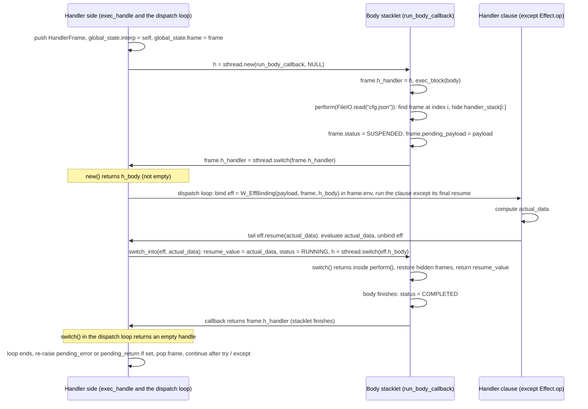

# EffectPython: Architectural Proof of Concept Plan

This document outlines the architecture and implementation specification for **EffectPython**, a Python dialect that introduces native algebraic effect management using the RPython framework. The goal is to maintain 100% syntactically valid Python 3 code (allowing standard IDEs, formatters, and linters to parse it without errors) while leveraging RPython's `rlib.rstacklet` stacklets (the primitive under PyPy's app-level `continulet`) for delimited stack suspension and resumption.

**Toolchain.** RPython is a subset of Python 2.7, and the translation toolchain runs on CPython 2.7 or PyPy2. Everything under `effectpython/` (lexer, parser, checker, interpreter) is therefore Python 2 code under RPython's restrictions, run and tested with a Python 2 `pytest` (4.6 is the last release that supports 2.7). The `.epy` programs that the interpreter reads are Python 3 syntax. The two never mix: the host interpreter parses `.epy` files with its own `rply` grammar and never imports them.

---

## Phase 1: Syntax and Semantics (The "Valid Python 3" Design)

To ensure every `.epy` file is valid Python 3 syntax (accepted by `ast.parse`), EffectPython uses standard Python 3 constructs (`class`, type annotations, `try`/`except`, and `with`) rather than custom keywords. The `rply` grammar in Phase 2 accepts a subset of that syntax.

Validity is syntactic. A type checker such as `mypy` rejects `str / [FileIO]` as an annotation, and CPython 3.13 and earlier evaluate annotations at definition time, so the `/` between a type and a list raises a `TypeError` when the module is imported. CPython 3.14 and later defer annotation evaluation and import the file. Either way, a `.epy` file is input for the EffectPython interpreter and for editors, not a module for CPython.

### 1.1 Declaring Effects and Operations
Effects are declared as classes inheriting from `Effect`, where methods define effect operations and their argument/return type signatures:

```python
from effectpython import Effect, perform, handle

class FileIO(Effect):
    def read(path: str) -> str: ...
    def write(path: str, content: str) -> int: ...

class DBQuery(Effect):
    def execute(sql: str) -> str: ...
```

The `import` line exists so an editor can resolve the names; the EffectPython parser accepts it and ignores it (2.1).

### 1.2 Declaring Effect Rows in Function Signatures
Function return annotations use the `/` binary operator over type hints to separate the return type from the effect row (`ReturnType / [Effect1, Effect2]`):

```python
def read_config(path: str) -> str / [FileIO]:
    return perform(FileIO.read(path))
```

*   **Pure functions:** Functions without `/ [...]` in their return annotation (e.g., `def add(a: int, b: int) -> int:`) have an implicit empty effect row `[]`.
*   **Effect granularity:** Effect rows track **Effect interfaces** (e.g., `FileIO`), while handlers must cover all operations of an effect interface to discharge that effect from the row.

### 1.3 Triggering Effects (`perform`)
`perform(EffectClass.operation(*args))` is a built-in runtime primitive. The parser folds `perform(FileIO.read(path))` into a single node; at runtime it evaluates the arguments, builds an effect payload (a `W_EffectPayload`, see 3.1) that records the effect, the operation, and the argument values, and suspends the current delimited continuation up to the nearest enclosing handler for `FileIO`.

### 1.4 Handling Effects (Valid Python 3 Syntax)
To remain valid Python 3 syntax while supporting multi-clause effect handling and resumption, EffectPython uses a `try` / `except` handler block with `handle()` (or a handler class, 1.5):

```python
def main() -> int / []:
    try:
        with handle(FileIO):
            config = read_config("settings.json")
            print(config)
    except FileIO.read as eff:
        # eff exposes the operation's parameters by name, plus eff.resume
        path = eff.path
        actual_data = read_host_file(path)
        eff.resume(actual_data)
    except FileIO.write as eff:
        written = write_host_file(eff.path, eff.content)
        eff.resume(written)
    return 0
```

> **Note on Execution Semantics:** Even though the surface syntax uses `try` / `except` with `with handle(...)` for Python 3 parser compatibility, the EffectPython AST evaluator compiles this construct into an **algebraic effect handler frame** (not a stack-unwinding exception). Calling `eff.resume(val)` returns control directly to the suspended `perform()` call site and runs the body until it finishes or a later clause abandons it; the clause for the body's next `perform` runs nested inside the `eff.resume(val)` call, unless that call is the clause's last statement, written as an expression statement on the clause's own binding, in which case the handler loops instead of nesting (3.4, steps 3 and 4). When the `with handle(...)` body completes normally, execution proceeds past the `try`/`except` block. A clause that finishes without calling `eff.resume(...)` also proceeds past the block, and the suspended body is abandoned (3.4, step 5). An exception raised inside the body is not caught by the `except Effect.op` clauses, which handle effects: it surfaces where the handler side regains control: inside the innermost `eff.resume(...)` call still waiting for the body, if there is one, and otherwise at the `with handle(...)` statement. From there it propagates out of the `try`/`except` block (3.4, steps 3 and 4).

### 1.5 Handler Classes (designed 2026-10-30, not yet implemented)
The `try`/`with handle`/`except` form in 1.4 writes the clauses inline,
so a handler that two functions need is written twice,
and a test cannot swap a program's handler for a fake one without editing the program.
A *handler class* fulfills one effect under a name, and a `with handle(...)` statement installs an instance of it over a body.
Its methods are the handler functions 1.4 refers to, one per operation.

The shape follows *Thinking in Python*.
Chapter 44's `ask_tell.py` declares `Ask` and `Tell` as Protocols and fulfills them with `Scripted` and `Capture`,
classes whose methods carry the operation's own signature and return the answer,
and `Capture` records what it was told in a dataclass field.
Appendix A sketches the attachment as `with handling(Ask, Scripted())`.
Koka's `with fun ask(prompt)` and Stateless's `handle(scripted)` resume with the handler's return value, once;
chapter 47 calls such a handler *tail-resumptive*.
A handler class here is the same thing: its methods return the value the body resumes with.
The inline clause of 1.4 keeps the explicit `eff.resume(...)`, and with it the power to abandon the body,
as Koka keeps `ctl` beside `fun`.

```python
from effectpython import Effect, Handler, perform, handle

class FileIO(Effect):
    def read(path: str) -> str: ...
    def write(path: str, content: str) -> int: ...

class Log(Effect):
    def note(text: str) -> int: ...

class FakeFileIO(Handler[FileIO]):
    def read(self, path: str) -> str:
        return "contents of " + path
    def write(self, path: str, content: str) -> int / [Log]:
        perform(Log.note("writing " + path))
        return 7

def read_config(path: str) -> str / [FileIO]:
    return perform(FileIO.read(path))

def load_app(name: str) -> int / [FileIO]:
    config = read_config(name + ".json")
    print(config)
    return perform(FileIO.write(name, config))

def main() -> int / []:
    try:
        with handle(Log):
            with handle(FakeFileIO()):
                print(load_app("settings"))
    except Log.note as eff:
        print("log:", eff.text)
        eff.resume(0)
    return 0
```

It prints `contents of settings.json`, `log: writing settings`, and `7`.

**Declaration.**
`class <Name>(Handler[<Effect>]):` declares a handler class for one effect.
It is valid Python 3 syntax (a subscript in the base list), and `Handler` comes from the ignored import line, as `Effect` does.
The body holds one method per operation of the effect, with the operation's name and signature plus a leading `self`,
and an optional effect row for the effects the method performs.
The method receives the operation's arguments as its parameters, so `path` arrives as `path`, not `eff.path`,
and the value it returns is the value the body's `perform(...)` evaluates to.
A method resumes the body once, when it returns; it cannot abandon the body or resume it twice,
so the one-shot error of 3.4 cannot arise from a handler class.
A program that needs to abandon the body writes an inline clause.
`self` is present for Python's sake and for the state that a later version adds (see the open questions); this version gives it nothing to hold.

**Use.**
`with handle(<Name>(), ...):` installs one handler frame over the body for every effect the named classes fulfill.
A constructor call names a handler class; a bare name names an effect, which needs inline clauses in the `try`/`except` form of 1.4.
The two may mix in one `handle(...)`:
`try: with handle(FakeFileIO(), DBQuery): ... except DBQuery.execute as eff: ...` fulfills `FileIO` through the class and `DBQuery` inline,
and a `handle(...)` whose arguments are all constructor calls needs no `try`.
Two arguments for the same effect are an error, as is a constructor call with arguments in this version.

**Checker.**
Pass 1 also collects handler classes and checks each one against its effect:
every operation has a method and no method names anything else,
the parameters after `self` match the operation's names and types, and the return type matches the operation's.
Pass 2 checks each method body as it checks a function body,
so an effect the method performs must appear in the method's row.
For a `handle(...)`, the body's effects minus every fulfilled or handled effect, plus the union of the methods' rows, flow to the enclosing function.
The checker also rejects a bare effect name with no clause for one of its operations, as today, and a clause for an effect a handler class fulfills.

**Runtime.**
A handler class adds no mechanism to 3.3 and 3.4.
The frame holds, per operation, either an `ast.Clause` or a handler method, and `clause_for` finds whichever the performed operation has.
For a method, `dispatch` calls it as a function with the payload's arguments, which gives it fresh locals,
and passes the returned value to `switch_into`, the same path a tail resume takes, so sequential performs use constant stack.
Effects a method performs resolve to outer handlers through the frame hiding of step 2, as a clause's do.

**Grammar additions (2.1).**
A class whose base is `Handler[<Name>]` becomes a `HandlerDef` node holding `FunctionDef` methods; a base of `Effect` still gives an `EffectDef`, and any other base is a syntax error.
A `handle(...)` argument may be `<Name>()` as well as `<Name>`, and a bare `with handle(<args>): <suite>` statement, outside `try`, becomes a `Handle` node with no clauses.

**Open questions**, to settle before implementing:
*   State. The book's `Capture` and `Recorder` record what they were told in instance fields, and a test reads the fields back.
    That needs `__init__` with parameters, `self.<field>` assignment and reads, and constructor arguments at the `handle(...)` site, so a test can reach the instance after the block.
    The syntax above leaves room for all of it, and none of it is in this version.
*   The base. `Handler[FileIO]` reads as a generic and marks the class as a fulfillment, not a declaration.
    The alternative, `class FakeFileIO(FileIO):`, is how Python implements an abstract interface, but it makes the handler an `Effect` subclass, and `perform(FakeFileIO.read(...))` would then need a rule to reject it.
*   Handler methods that need the binding. A method cannot abandon the body. If a case turns up that needs both reuse and abandonment, the options are a `Handler` method that returns nothing and calls `eff`-style methods on `self`, or a second base, `Control[FileIO]`, whose methods take the binding as the inline clause does.

---

## Phase 2: The Frontend (Parser and Static Effect Checker)

The frontend guarantees at compile-time that no effect is triggered without a matching handler up the call stack, and that all handlers for an effect interface are exhaustive.

### 2.1 Minimal Grammar Subset (`rply`)
`rply` provides a lexer generator and an LALR parser generator, and no Python grammar; the EffectPython grammar is written from scratch. Because implementing the full Python 3 grammar in `rply` is out of scope for a PoC, the lexer and parser will target a strict, well-defined subset of Python 3:
*   **Lexer tokens:** Indentation tracking (`INDENT`, `DEDENT`, `NEWLINE`, produced by a post-processor over `rply`'s token stream, since `rply` has no indentation support), identifiers (`NAME`), keywords (`class`, `def`, `return`, `pass`, `if`, `else`, `while`, `try`, `except`, `as`, `with`, `from`, `import`), literals (`INT`, `STRING`), the stub body `...` (`ELLIPSIS`), operators (`+`, `-`, `*`, `/`, `==`, `=`, `->`, `:`, `.`, `,`), and delimiters (`(`, `)`, `[`, `]`).
*   **Statements:**
    *   `from effectpython import <names>` (accepted and ignored)
    *   `class <Name>(Effect):` with method signature stubs (`def <op>(...) -> <Type>: ...`)
    *   `def <name>(<params>) -> <ReturnType> [/ [<Effects>]]: <suite>`
    *   `return <expr>`, `pass`, assignment `<name> = <expr>`, expression statements
    *   `if <expr>: <suite> else: <suite>`
    *   `while <expr>: <suite>` (added 2026-10-30 for `tests/programs/many_performs.epy`)
    *   `try: with handle(<Effects>): <suite> except <Effect>.<op> as <name>: <suite>`
*   **Expressions:** Integer/string literals, variable references, binary arithmetic, function calls (including `print(...)`), attribute calls (`Effect.op(...)`), attribute reads (`<name>.<param>` on an `eff` binding), `perform(<expr>)`, and `<name>.resume(<expr>)`.

Two constraints on the lexer, found when translating `experiments/rply_addition.py` (2026-10-28), which confirmed that `rply` 0.7.8 translates with this toolchain:

*   The parser never consumes `rply`'s `LexerStream` directly. `LRParser.parse` fetches tokens with the `next()` built-in, and RPython's `next` operation propagates only `StopIteration` (`canraise` in `rpython/flowspace/operation.py`), so a `LexingError` raised inside the stream's `next()` vanishes in the translated binary and the parser sees end of input: `1 - 2` parsed as `1` with exit code 0. The INDENT/DEDENT post-processor therefore lexes the whole file into a token list, calling the stream's `next()` method directly inside `try`/`except LexingError`, and the parser reads an iterator over that list whose `next()` raises only `StopIteration`.
*   Every error the frontend raises carries a `msg` attribute, because `str(e)` on an exception prints an object address when translated, and `repr()` on a string is not RPython. For a lexing error, the failing column comes from `getsourcepos().idx`; its `colno` is the column of the previous token.

### 2.2 Static Effect Inference & Verification Algorithm
The static analyzer runs in three passes over the AST before execution:

1.  **Pass 1 — Effect & Function Signature Collection:**
    *   Collects all `Effect` subclasses and their declared operations (`op_name -> (param_names, arg_types, return_type)`).
    *   Collects all function signatures (`func_name -> (param_types, return_type, declared_effect_row)`).
    *   Allows recursive and mutually recursive functions by seeding the symbol table from explicit annotations before checking function bodies.
2.  **Pass 2 — Intra-Procedural Effect Verification:**
    *   For each function body, computes the active `inferred_effects: set[str]` of each AST node bottom-up:
        *   `PerformNode(Effect.op, args)`: produces `{Effect}`, verifies `args` match `Effect.op`'s parameter types, and types the `perform` expression with `Effect.op`'s return type.
        *   `CallNode(callee, args)`: looks up `callee` in the function table and unions `callee.declared_effect_row` into the current scope's `inferred_effects`.
        *   `HandleNode(handled_effects, body, clauses)`:
            1. Verifies that for every `E` in `handled_effects`, `clauses` provide an `except E.op as eff:` clause for **every** operation declared on `E` (exhaustiveness check).
            2. Types `eff.<param>` inside each clause from `E.op`'s parameter names and types, and verifies that `eff.resume(val)` is called with a `val` matching `E.op`'s return type.
            3. Computes the net effect of the `HandleNode` as:
               $$\text{Effects}(\text{HandleNode}) = (\text{Effects}(\text{body}) \setminus \text{handled\_effects}) \cup \bigcup_{c \in \text{clauses}} \text{Effects}(c)$$
    *   **Signature Check:** After checking a function's body, if $\text{Effects}(\text{body}) \not\subseteq \text{declared\_effect\_row}$, raise a compile-time `UnhandledEffectError` listing the undeclared effects and their source line numbers.
3.  **Pass 3 — Entrypoint Verification:**
    *   Verifies that `main()` exists and its `declared_effect_row` is empty (`[]`).

---

## Phase 3: The Backend Runtime (RPython Object Model & Stacklets)

RPython is a statically typed subset of Python 2 that compiles to C. The interpreter cannot pass untyped Python objects around; it requires a boxed object hierarchy, and since a stacklet switch carries no value (3.2), a mailbox object to transfer data across switches.

### 3.1 Boxed Runtime Value Hierarchy (`W_Root`)
All runtime values inherit from a single base class `W_Root` so `eval_ast` has a uniform RPython return type:

```python
class W_Root(object):
    _attrs_ = []

class W_None(W_Root): pass
class W_Bool(W_Root):
    def __init__(self, val): self.val = val  # rpython bool
class W_Int(W_Root):
    def __init__(self, val): self.val = val  # rpython int

class W_Str(W_Root):
    def __init__(self, val): self.val = val  # rpython str

class W_EffectPayload(W_Root):
    def __init__(self, effect_name, op_name, args_w):
        self.effect_name = effect_name
        self.op_name = op_name
        self.args_w = args_w  # list[W_Root]

class W_EffBinding(W_Root):
    """Bound to `eff` in `except Effect.op as eff:`"""
    def __init__(self, payload, frame, h_body):
        self.payload = payload  # W_EffectPayload
        self.frame = frame      # HandlerFrame
        self.h_body = h_body    # stacklet handle of the suspended body; consumed by resume()
```

`eff.path` resolves through the operation's declared parameter names: the interpreter looks up `"Effect.op"` in an operations table it builds from the module's effect declarations and indexes `args_w` by the parameter's position. In `model.py` every class declares `_attrs_`, which this sketch omits, and the module also holds the prebuilt `w_None`, `w_True`, and `w_False`.

### 3.2 How `rlib.rstacklet` Works
`rpython.rlib.rstacklet` is the RPython-level primitive under PyPy's app-level `continulet`; there is no `continulet` class at the RPython level. The module exposes one class, `StackletThread`, with four methods:

```python
from rpython.rlib import rstacklet
sthread = rstacklet.StackletThread()  # one per OS thread; EffectPython creates it at the first handle statement
h = sthread.new(callback, arg)        # start a stacklet running callback(h, arg); returns when it switches away or finishes
h = sthread.switch(h)                 # jump to the stacklet behind h; returns when something switches back
sthread.is_empty_handle(h)            # True when the stacklet behind h has finished
sthread.get_null_handle()             # placeholder for a field that holds no handle yet
```

Four rules follow from that API, and 3.3 and 3.4 are built on them:

1.  **`new()` runs the body at once.** Unlike the app-level `continulet`, whose callable waits for the first `switch()`, `new()` enters `callback` immediately. The callback has the signature `callback(h, arg)`, where `h` is the handle of the side that called `new()`. The callback must return a handle, and the stacklet finishes by switching to that handle.
2.  **Handles are one-shot and change on every switch.** `switch(h)` consumes `h` and returns a fresh handle for whichever stacklet just switched into the caller. The same holds for the handle `new()` returns. Switching to a consumed handle is undefined behavior at the C level, so the interpreter enforces one-shot resumption itself (3.4, step 4).
3.  **A finished stacklet yields an empty handle.** When the callback returns, the side it switches to receives a handle for which `is_empty_handle()` is true. That is the only completion signal, so the mailbox carries the result.
4.  **Nothing crosses a switch except control.** `switch()` carries no value, and `new()`'s `arg` is a raw `llmemory.Address`, unusable for `W_Root` objects. PyPy's `_continuation` module passes the continulet to its callback through a module-level `global_state` object and transports exceptions the same way (`global_state.propagate_exception`). EffectPython does the same: a `HandlerFrame` mailbox holds everything that travels between the handler and the body, including any exception the body raises, because an RPython exception that escapes the callback cannot propagate across the switch.

Three constraints on translation and testing:

*   Translation needs `--continuation` (`rstacklet` asserts `config.translation.continuation`). The `shadowstack` GC root finder, the default, is the one that supports stacklets, and `--gc=boehm` is incompatible with `--continuation`. So is `-O0`, which selects the refcounting GC; translate at the default optimization level.
*   Stacklets cannot run untranslated on a PyPy host. `rstacklet._getgcrootfinder` has an untranslated branch (`gcrootfinder = 'n/a'`, commented `# for tests`), but when the host is PyPy it skips with "calling directly the C function stacklet_switch() will crash". The only Python 2 host on this machine is PyPy2, so every test that performs an effect runs through a translated binary. A small target translates in about 15 seconds, which keeps the loop tolerable. The experiment in `experiments/stacklet_mailbox.py` (2026-10-28) confirmed the four rules above in a translated binary, including resumption after a GC collection with a 2k nursery and a body abandoned mid-suspension.
*   Any target that uses `rstacklet` links `rvmprof.c`, and gcc fails on an undeclared `__vmprof_eval_vmprof` unless a function decorated with `rvmprof.vmprof_execute_code` is reachable from the entry point. The stub in `experiments/stacklet_mailbox.py` provides one; its guard must depend on `argv`, because the translator's constant folding removes a `NonConstant(False)` guard along with the stub.

### 3.3 The `HandlerFrame` and Context Stack
The `Interpreter` holds the handler stack as an instance attribute, `handler_stack`, a list of `HandlerFrame`,
and its `sthread`, which the first `handle` statement creates rather than startup:
a `StackletThread` cannot be built untranslated, and the unit tests construct interpreters without one.
A module-level `global_state` carries the interpreter and the frame into the body callback,
whose only argument is a raw address (3.2, rule 4).
Each `HandlerFrame` keeps the `ast.Handle` node it runs, so its effects and clauses come from the node:

```python
class HandlerFrame(object):
    def __init__(self, stmt, env, sthread):
        self.stmt = stmt              # ast.Handle: effects (list[str]) and clauses (list[ast.Clause])
        self.env = env                # Environment of the function containing the handle statement
        self.h_handler = sthread.get_null_handle()  # handle of the handler side, held by the body; replaced on every switch
        # Mailbox fields for communicating across a switch:
        self.status = STATUS_RUNNING  # RUNNING | SUSPENDED | COMPLETED
        self.pending_payload = None   # W_EffectPayload set by perform()
        self.resume_value = None      # W_Root set by eff.resume(val); perform() clears it when it returns the value
        self.pending_error = None     # EffectError the body raised, re-raised on the handler side
        self.pending_return = None    # ReturnSignal from a return statement in the body, re-raised the same way
        self.saved_frames = []        # list[HandlerFrame]: this frame and the inner frames, hidden while a clause runs
```

`handles(effect_name)` tests the node's effect list,
and `clause_for(payload)` searches its clauses in order;
the checker guarantees a match, so the `EffectPythonRuntimeError` for a miss is unreachable from the binary.
The body is a suite, so it produces no value and the frame stores none: `eff.resume()` evaluates to `None`.
The handle of the suspended body lives in the `W_EffBinding`, not in the frame, so each suspension has its own one-shot token.

### 3.4 Step-by-Step Control Flow (`handle` -> `perform` -> `resume`)

The diagram shows the common case, a clause that ends with `eff.resume(...)`, which the handler side runs from its dispatch loop without nesting (step 4 covers the other shape).



1.  **Entering `with handle(...)` (`Interpreter.exec_handle`):**
    *   Create `sthread` if this is the first `handle` statement.
        Instantiate `frame = HandlerFrame(stmt, env, sthread)`, push it onto `handler_stack`, and set `global_state.interp` and `global_state.frame`.
    *   Call `h = sthread.new(run_body_callback, llmemory.NULL)`.
        `run_body_callback(h, arg)` reads the interpreter and the frame from `global_state`, stores `frame.h_handler = h`,
        and runs the `with` body through `exec_block` inside a `try` that stores an `EffectError` in `frame.pending_error`
        and a `ReturnSignal` (a `return` statement in the body) in `frame.pending_return`;
        any other RPython exception is an interpreter bug and aborts the binary.
        It then sets `frame.status = STATUS_COMPLETED` and returns `frame.h_handler`, which finishes the stacklet.
    *   `new()` returns on the handler side either when the body first performs (with a live handle) or when it finishes (with an empty handle).
        Call `dispatch(frame, h)` (step 3) inside a `try`/`finally` that pops the top of `handler_stack` when `frame.status == STATUS_COMPLETED`:
        a body that completed has put the frame back on top (step 2), and a body a clause abandoned left it hidden, so nothing is popped.
        The `finally` runs whether `dispatch` returned or raised.
2.  **Executing `perform(Effect.op(*args))` (`Interpreter.perform`):**
    *   The parser folds `perform(Effect.op(...))` into one `Perform` node,
        so `eval_expr` evaluates the arguments to `list[W_Root]` and `perform(effect_name, op_name, args_w)` builds the `W_EffectPayload`.
        A bare `Effect.op(...)` (an `OpCall` node) also evaluates to a payload, but the checker rejects it.
    *   Search `handler_stack` from top to bottom for the nearest frame whose `handles(effect_name)` is true, at index `i`.
    *   Hide the frame and everything above it, so effects performed *inside* the handler clause resolve to outer handlers:
        `frame.saved_frames = handler_stack[i:]`, then `del handler_stack[i:]`.
        The inner frames' stacklets stay suspended inside the body's C stack slice.
    *   Store `frame.pending_payload = W_EffectPayload(effect_name, op_name, args_w)` and `frame.status = STATUS_SUSPENDED`.
    *   Call `frame.h_handler = sthread.switch(frame.h_handler)`.
        This pauses the C stack slice (including any intermediate function calls between `handle` and `perform`) and returns control to the handler side,
        which is either `new()` in step 1 or `switch()` inside `switch_into` (step 4).
        The assignment stores the fresh handle of whichever side resumes the body.
    *   When the switch returns, `handler_stack.extend(frame.saved_frames)`, reset `saved_frames` to `[]`,
        and return `frame.resume_value`, clearing the field.
3.  **Dispatching the Handler Clause (`Interpreter.dispatch(frame, h)`), a loop:**
    *   While `h` is not empty, the body is suspended and `frame.pending_payload` holds the performed operation.
        Find the clause with `frame.clause_for(payload)` and create `eff = W_EffBinding(payload, frame, h)`.
    *   Bind the clause's name in `frame.env`, the environment of the function containing the `handle` statement,
        the same scope Python gives `except ... as e`, remembering any earlier value of that name.
        Run the clause's statements, and afterwards, in a `finally`, restore the earlier value or delete the name.
        Nested clauses (step 4) share this environment, so the restore is what keeps an outer clause's `eff` intact.
    *   If the clause's last statement is `eff.resume(<expr>)` on its own binding (`tail_resume`),
        run every statement but that one, evaluate `<expr>` with the binding still in scope,
        and after the `finally` call `h = switch_into(eff, value)` (step 4) and return to the top of the loop.
        Otherwise return once the clause finishes.
    *   When `h` is empty, the body finished:
        re-raise `frame.pending_error` if it is set, then `frame.pending_return` if it is set, and otherwise return.
        `dispatch` returns no value.
4.  **Resuming with `eff.resume(val_w)` (`Interpreter.switch_into` and `Interpreter.resume`):**
    *   `switch_into(eff, val_w)`: if `eff.h_body` is empty (`is_empty_handle`, which for the shadowstack backend is the null-handle test),
        the binding was already consumed: raise a runtime `OneShotContinuationError("Cannot resume a suspended body more than once")`.
        Otherwise take `h = eff.h_body`, set `eff.h_body` to the null handle, set `frame.resume_value = val_w` and `frame.status = STATUS_RUNNING`,
        and return `sthread.switch(h)`, which swaps the C stack back to the paused `perform()` site and returns when the body performs again or finishes.
        Inside the body, `perform` restores the hidden frames and returns `frame.resume_value` as the result of `perform(...)`.
    *   `resume(eff, val_w)`, for an `eff.resume(...)` anywhere but a clause's tail:
        `h = switch_into(eff, val_w)`, then `dispatch(frame, h)`, then return `W_None`.
        The clause for the body's next `perform` therefore runs nested inside this `resume()` call,
        and the body's exception or `return` surfaces here, so the statements after the `resume()` do not run.
        Control returns to the clause only when the body finishes or a nested clause abandons it.
    *   A tail `eff.resume(...)` never goes through `resume()`: `dispatch` switches from its own loop (step 3),
        so N sequential performs handled by tail resumes use constant stack,
        and the body's exception surfaces at the end of the loop, at the `handle` statement or inside the enclosing `resume()`.
        Only an expression statement counts as a tail; `x = eff.resume(v)` or `return eff.resume(v)` nests.
        (Implemented 2026-10-30, after `tests/programs/many_performs.epy` showed the nested form overflowing between 1600 and 1800 performs; see the Milestone 3 notes.)
    *   The `.epy` dialect has no way to catch the body's exception, so it propagates through every clause nested on the handler side,
        out of the `try`/`except` block, and up to `entry_point`, which reports it and exits 1.
5.  **Non-Resuming Handlers (Abort / Early Exit):**
    *   If a handler clause finishes without calling `eff.resume(...)`, `dispatch` returns,
        the suspended body stays hidden and is abandoned, and execution proceeds past the `try`/`except` block.
    *   `StackletThread` has no `destroy` method.
        The `shadowstack` backend frees an abandoned stacklet from its GC destructor when the handle object becomes unreachable,
        so dropping the `W_EffBinding`, with the handle inside it, is the whole cleanup; nothing sets `eff.h_body` to null on this path.

---

## Phase 4: Project Layout, Milestones, and Verification

### 4.1 Directory Structure
```text
EffectPython/
├── targeteffectpython.py   # RPython translation entry_point(argv) and target()
├── conftest.py             # Present so pytest puts the repository root on sys.path
├── pytest.ini              # testpaths = tests, python_files = test_*.py
├── CLAUDE.md               # Project instructions: dialect rules, style, toolchain
├── LICENSE
├── README.md
├── effectpython_implementation_plan.md
├── effectpython/
│   ├── __init__.py
│   ├── lexer.py            # rply Lexer + INDENT/DEDENT post-processor
│   ├── parser.py           # rply Parser -> AST nodes
│   ├── ast_nodes.py        # RPython-compatible AST node classes
│   ├── checker.py          # Static effect row inference & exhaustiveness checker
│   ├── model.py            # W_Root, W_None, W_Bool, W_Int, W_Str, W_EffectPayload, W_EffBinding
│   ├── interpreter.py      # AST evaluator, HandlerFrame, rstacklet integration
│   ├── samples.py          # Hand-built Fibonacci AST, used by test_interpreter.py and test_parser.py
│   └── errors.py           # EffectError and its subclasses: InvalidSyntax, InvalidProgram, UnhandledEffectError, EffectPythonRuntimeError, OneShotContinuationError
├── experiments/
│   ├── rply_addition.py    # rply translates (2.1)
│   └── stacklet_mailbox.py # The four rstacklet rules in a translated binary (3.2)
└── tests/
    ├── support.py          # read_program, shape, ListOutput
    ├── test_interpreter.py # Milestone 1
    ├── test_parser.py      # Milestone 2, lexer and parser
    ├── test_checker.py     # Milestone 2, checker
    ├── test_runtime.py     # Milestones 3 and 4: translate once, run every program in programs/
    └── programs/           # <name>.epy with its <name>.expected beside it
```

### 4.2 Implementation Milestones & Acceptance Criteria

1.  **Milestone 1: The Core Evaluator (`ast_nodes.py`, `model.py`, `interpreter.py`)**
    *   Build the `W_Root` hierarchy and an RPython-compliant AST evaluator supporting functions, local lexical environments, arithmetic, conditionals, and `print`.
    *   *Acceptance test:* Run a recursive Fibonacci `.epy` script untranslated under a Python 2.7 `pytest`. Done 2026-10-28 with a hand-built AST (`samples.build_fib_module`), since the parser comes in Milestone 2; `tests/test_interpreter.py` runs it with `pypy2 -m pytest`, and `targeteffectpython.py` runs it both untranslated and as a translated binary.
2.  **Milestone 2: The Frontend & Static Effect Checker (`lexer.py`, `parser.py`, `checker.py`)**
    *   Implement the `rply` parser for the EffectPython grammar subset and the 3-pass static effect analyzer.
    *   *Done 2026-10-29.* `lexer.py` and `parser.py` cover the full grammar of 2.1: the import line (accepted, no node), `class <Name>(Effect):` with operation stubs, function definitions with typed parameters, a return type, and an optional `/ [...]` effect row; `return`, assignment, expression, `pass`, `if`/`else`, and `try`/`with handle`/`except` statements; literals, names, arithmetic, comparisons, calls, attribute reads, and attribute calls. The parser folds `perform(Effect.op(...))` into a `Perform` node and `name.resume(x)` into a `Resume` node, checks that `with` uses `handle(...)` and that a class derives from `Effect`, and raises `InvalidSyntax` with a 1-based line and column. `checker.py` runs the three passes of 2.2 over the parsed module: undeclared effects raise `UnhandledEffectError`, and every other static mistake (unknown effect or operation, a `handle` block missing a clause or naming a clause for an effect it does not handle, a `perform()`, `resume()`, or call with the wrong number or types of arguments, an `eff.<attr>` that is not a parameter, a bare `Effect.op(...)`, an undefined function, a duplicate declaration, or a `main()` with parameters) raises `InvalidProgram`; both carry the line number. Types are inferred only as far as those argument checks need, and an expression of unknown type matches any declared type. `targeteffectpython.py` parses, checks, then runs the `.epy` file named on the command line. `tests/test_parser.py` checks the parsed `tests/programs/fib.epy` against `samples.build_fib_module`, and `tests/test_checker.py` holds the three acceptance tests below plus the rejected cases, with `tests/programs/read_config.epy` (a three-function chain, Milestone 3's first program) as the accepted program. From 2026-10-30, three rejected programs (`rejected_syntax.epy`, `rejected_unhandled.epy`, `rejected_missing_clause.epy`) run through the translated binary in `tests/test_runtime.py`, so the `error: <msg>` line and exit code 1 for a syntax error, an `UnhandledEffectError`, and an `InvalidProgram` are covered end to end.
    *   *Acceptance test:*
        *   Reject a function that calls `perform(FileIO.read("a"))` without `/ [FileIO]` in its signature (`UnhandledEffectError`).
        *   Reject a `with handle(FileIO):` block missing an `except` clause for one of `FileIO`'s declared operations.
        *   Accept a valid program where `main() -> int / []` handles all effects of its callees.
3.  **Milestone 3: Delimited Suspension & Resumption (`rlib.rstacklet`)**
    *   Implement `HandlerFrame`, the handler context stack, `perform` suspension across nested function calls, and `eff.resume(val)` resumption.
    *   *Acceptance test:*
        *   Single `perform` and `resume` across a 3-function-deep call chain (`main` -> `load_app` -> `read_config` -> `perform`).
        *   Multiple sequential `perform` calls inside the same `with handle(...)` block.
        *   Nested `with handle(DBQuery):` inside `with handle(FileIO):` routing effects to the correct handler frame.
        *   Raising `OneShotContinuationError` if a handler calls `eff.resume()` twice.
        *   A clause that finishes without resuming, after which execution continues past the `try`/`except` block.
        *   An exception raised inside the handled body, re-raised on the handler side.
    *   These run through a translated binary, since stacklets cannot run untranslated on the PyPy host (3.2). Build the translation entry point from Milestone 4 before this milestone, and give each acceptance test an `.epy` program that the binary runs; `tests/test_runtime.py` translates once per session and compares each program's output. The handler-side mailbox in `experiments/stacklet_mailbox.py` is the starting point for `HandlerFrame`.
    *   *Harness in place 2026-10-29.* `tests/test_runtime.py` translates `targeteffectpython.py` once per session into a pytest scratch directory (the driver copies the binary into the working directory, so the fixture runs the translation from there) and runs every `tests/programs/*.epy` through it, comparing the exit code and stdout with the `<name>.expected` file beside the program (first line `exit <code>`, then the stdout). The seven acceptance programs (`read_config.epy`, `sequential.epy`, `nested.epy`, `double_resume.epy`, `abort.epy`, `body_error.epy`, and, from 2026-10-30, `resume_then_error.epy`) are written, parse, and pass the checker; each was a strict `xfail` until the runtime existed. `EFFECTPYTHON_BINARY` names a binary translated earlier to skip the translation.
    *   *Done 2026-10-30.* `interpreter.py` holds `HandlerFrame`, the handler stack, the body callback, and the four steps of 3.4 as `exec_handle`, `perform`, `dispatch`, `switch_into`, and `resume`; `model.py` holds `W_EffBinding`. The `rstacklet` import is guarded so the unit tests import the module without RPython on the path. All ten programs then in `tests/programs/` pass through the translated binary, also with `PYPY_GC_NURSERY=2k`; `return_in_body.epy` and `return_in_clause.epy` cover a `return` statement inside the body (surfaces inside `resume()` through a `pending_return` field beside `pending_error`) and inside a clause (abandons the body). A clause's binding is defined in the function's environment for the clause's duration and removed, or restored to its earlier value, afterwards, so nested clauses cannot overwrite an outer clause's `eff`.
    *   *Depth limit, measured 2026-10-30.* Because the handler is deep (3.4, step 4), `tests/programs/many_performs.epy` with ten thousand sequential performs aborts with `Fatal RPython error: StackOverflow` and exit code 134. The overflow sits between 1600 and 1800 nested performs, and comes from RPython's own stack guard (`MAX_STACK_SIZE` in `rpython/translator/c/src/stack.h`), so raising the shell's stack limit does not move it. `while` was added to the grammar for this program. The tail-resume form of step 4 (an `eff.resume(...)` that ends its clause switches into the body from `dispatch`'s loop, without nesting) went in the same day, and the program is back to ten thousand performs, which pass. A `resume()` followed by more statements still nests, since the clause must get control back.
4.  **Milestone 4: RPython Translation (`targeteffectpython.py`)**
    *   Write `entry_point(argv)` and `target(driver, args)` conforming to RPython's static typing constraints (no dynamic attribute creation, homogeneous lists, uniform `W_Root` returns).
    *   Include the `rvmprof` stub from `experiments/stacklet_mailbox.py`, guarded by an `argv` check, so that `rvmprof.c` compiles (3.2). Translate with `--batch` so a failure prints instead of opening a debugger.
    *   *Acceptance test:* Translate with `rpython --continuation targeteffectpython.py` into a standalone native executable (`effectpython-c`), execute sample `.epy` programs natively, and run the Milestone 3 programs against the binary.
    *   *Done 2026-10-30.* The target was in place from Milestone 2, and `tests/test_runtime.py` performs this acceptance test on every run: it translates the target (or uses the binary `EFFECTPYTHON_BINARY` names) and runs all of `tests/programs/` through the binary.
5.  **Milestone 5: Handler Classes (1.5)**
    *   Implement the grammar additions, the `HandlerDef` node and the clause-less `Handle`, the Pass 1 and Pass 2 checks, and the per-operation clause-or-method record in the runtime.
    *   *Acceptance test:*
        *   The program in 1.5 prints `contents of settings.json`, `log: writing settings`, and `7` through the translated binary.
        *   Reject a handler class missing a method for one operation, one with a method that is not an operation, one whose method signature differs from the operation's, and one whose method performs an effect missing from its row.
        *   Reject `with handle(FileIO):` with no `try`, a clause for an effect a handler class fulfills, and two arguments for one effect.
        *   One `handle(FakeFileIO(), DBQuery)` with an inline clause for `DBQuery.execute`.
        *   Two handler classes for one effect, chosen at two call sites, give two outputs.
        *   Ten thousand performs fulfilled by a handler method pass, as `many_performs.epy` does for a tail resume.
    *   Not started. The open questions in 1.5 come first.
