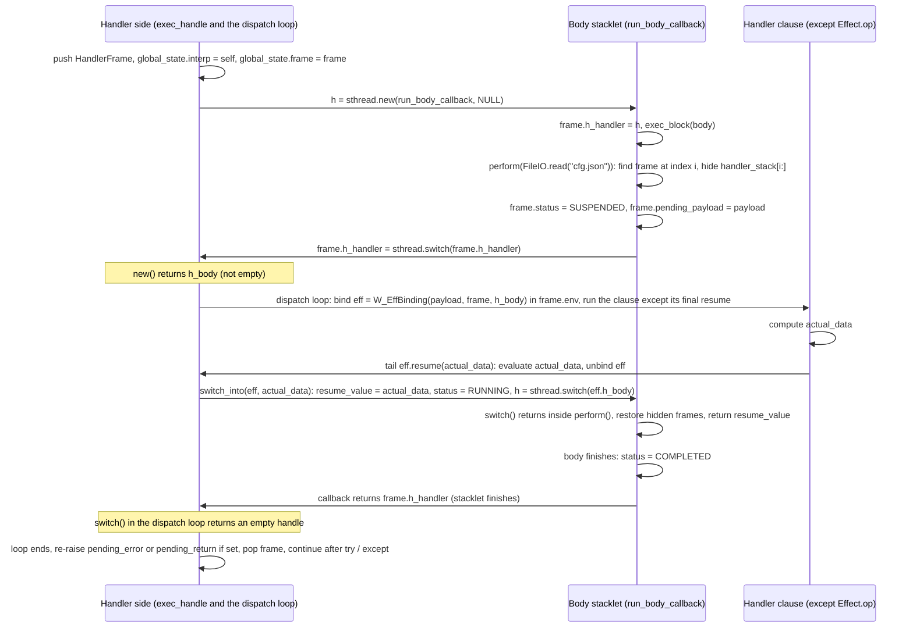

# EffectPython: Architectural Proof of Concept Plan

This document outlines the architecture and implementation specification for **EffectPython**, a Python dialect that introduces native algebraic effect management using the RPython framework. The goal is to maintain 100% syntactically valid Python 3 code (allowing standard IDEs, formatters, and linters to parse it without errors) while leveraging RPython's `rlib.rstacklet` stacklets (the primitive under PyPy's app-level `continulet`) for delimited stack suspension and resumption.

**Toolchain.** RPython is a subset of Python 2.7, and the translation toolchain runs on CPython 2.7 or PyPy2. Everything under `effectpython/` (lexer, parser, checker, interpreter) is therefore Python 2 code under RPython's restrictions, run and tested with a Python 2 `pytest` (4.6 is the last release that supports 2.7). The `.epy` programs that the interpreter reads are Python 3 syntax. The two never mix: the host interpreter parses `.epy` files with its own `rply` grammar and never imports them.

---

## Phase 1: Syntax and Semantics (The "Valid Python 3" Design)

To ensure every `.epy` file is valid Python 3 syntax (accepted by `ast.parse`), EffectPython uses standard Python 3 constructs (`class`, type annotations, `try`/`except`, and `with`) rather than custom keywords. The `rply` grammar in Phase 2 accepts a subset of that syntax.

Validity is syntactic. A type checker such as `mypy` rejects `str / [FileIO]` as an annotation, and CPython 3.13 and earlier evaluate annotations at definition time, so the `/` between a type and a list raises a `TypeError` when the module is imported. CPython 3.14 and later defer annotation evaluation and import the file. Either way, a `.epy` file is input for the EffectPython interpreter and for editors, not a module for CPython.

### 1.1 Declaring Effects and Operations
Effects are declared as classes inheriting from `Effect`, where methods define effect operations and their argument/return type signatures:

```python
from effectpython import Effect, perform, handle

class FileIO(Effect):
    def read(path: str) -> str: ...
    def write(path: str, content: str) -> int: ...

class DBQuery(Effect):
    def execute(sql: str) -> str: ...
```

The `import` line exists so an editor can resolve the names; the EffectPython parser accepts it and ignores it (2.1).

### 1.2 Declaring Effect Rows in Function Signatures
Function return annotations use the `/` binary operator over type hints to separate the return type from the effect row (`ReturnType / [Effect1, Effect2]`):

```python
def read_config(path: str) -> str / [FileIO]:
    return perform(FileIO.read(path))
```

*   **Pure functions:** Functions without `/ [...]` in their return annotation (e.g., `def add(a: int, b: int) -> int:`) have an implicit empty effect row `[]`.
*   **Effect granularity:** Effect rows track **Effect interfaces** (e.g., `FileIO`), while handlers must cover all operations of an effect interface to discharge that effect from the row.

### 1.3 Triggering Effects (`perform`)
`perform(EffectClass.operation(*args))` is a built-in runtime primitive. The parser folds `perform(FileIO.read(path))` into a single node; at runtime it evaluates the arguments, builds an effect payload (a `W_EffectPayload`, see 3.1) that records the effect, the operation, and the argument values, and suspends the current delimited continuation up to the nearest enclosing handler for `FileIO`.

### 1.4 Handling Effects (Valid Python 3 Syntax)
To remain valid Python 3 syntax while supporting multi-clause effect handling and resumption, EffectPython uses a `try` / `except` handler block with `handle()` (or a handler class, 1.5):

```python
def main() -> int / []:
    try:
        with handle(FileIO):
            config = read_config("settings.json")
            print(config)
    except FileIO.read as eff:
        # eff exposes the operation's parameters by name, plus eff.resume
        path = eff.path
        actual_data = read_host_file(path)
        eff.resume(actual_data)
    except FileIO.write as eff:
        written = write_host_file(eff.path, eff.content)
        eff.resume(written)
    return 0
```

> **Note on Execution Semantics:** Even though the surface syntax uses `try` / `except` with `with handle(...)` for Python 3 parser compatibility, the EffectPython AST evaluator compiles this construct into an **algebraic effect handler frame** (not a stack-unwinding exception). Calling `eff.resume(val)` returns control directly to the suspended `perform()` call site and runs the body until it finishes or a later clause abandons it; the clause for the body's next `perform` runs nested inside the `eff.resume(val)` call, unless that call is the clause's last statement, written as an expression statement on the clause's own binding, in which case the handler loops instead of nesting (3.4, steps 3 and 4). When the `with handle(...)` body completes normally, execution proceeds past the `try`/`except` block. A clause that finishes without calling `eff.resume(...)` also proceeds past the block, after the suspended body is unwound, which runs its `finally` suites (1.8; 3.4, step 5). An exception raised inside the body is not caught by the `except Effect.op` clauses, which handle effects: it surfaces where the handler side regains control: inside the innermost `eff.resume(...)` call still waiting for the body, if there is one, and otherwise at the `with handle(...)` statement. From there it propagates out of the `try`/`except` block (3.4, steps 3 and 4).

### 1.5 Handler Classes (designed 2026-10-30, open questions settled 2026-10-31, implemented 2026-10-31)
The `try`/`with handle`/`except` form in 1.4 writes the clauses inline,
so a handler that two functions need is written twice,
and a test cannot swap a program's handler for a fake one without editing the program.
A *handler class* fulfills one effect under a name, and a `with handle(...)` statement installs an instance of it over a body.
Its methods are the handler functions 1.4 refers to, one per operation.

The shape follows *Thinking in Python*.
Chapter 44's `ask_tell.py` declares `Ask` and `Tell` as Protocols and fulfills them with `Scripted` and `Capture`,
classes whose methods carry the operation's own signature and return the answer,
and `Capture` records what it was told in a dataclass field.
Appendix A sketches the attachment as `with handling(Ask, Scripted())`.
Koka's `with fun ask(prompt)` and Stateless's `handle(scripted)` resume with the handler's return value, once;
chapter 47 calls such a handler *tail-resumptive*.
A handler class here is the same thing: its methods return the value the body resumes with.
The inline clause of 1.4 keeps the explicit `eff.resume(...)`, and with it the power to abandon the body,
as Koka keeps `ctl` beside `fun`.

```python
from effectpython import Effect, Handler, perform, handle

class FileIO(Effect):
    def read(path: str) -> str: ...
    def write(path: str, content: str) -> int: ...

class Log(Effect):
    def note(text: str) -> int: ...

class FakeFileIO(Handler[FileIO]):
    def read(self, path: str) -> str:
        return "contents of " + path
    def write(self, path: str, content: str) -> int / [Log]:
        perform(Log.note("writing " + path))
        return 7

def read_config(path: str) -> str / [FileIO]:
    return perform(FileIO.read(path))

def load_app(name: str) -> int / [FileIO]:
    config = read_config(name + ".json")
    print(config)
    return perform(FileIO.write(name, config))

def main() -> int / []:
    try:
        with handle(Log):
            with handle(FakeFileIO()):
                print(load_app("settings"))
    except Log.note as eff:
        print("log:", eff.text)
        eff.resume(0)
    return 0
```

It prints `contents of settings.json`, `log: writing settings`, and `7`.

**Declaration.**
`class <Name>(Handler[<Effect>]):` declares a handler class for one effect.
It is valid Python 3 syntax (a subscript in the base list), and `Handler` comes from the ignored import line, as `Effect` does.
The body holds one method per operation of the effect, with the operation's name and signature plus a leading `self`,
and an optional effect row for the effects the method performs.
The method receives the operation's arguments as its parameters, so `path` arrives as `path`, not `eff.path`,
and the value it returns is the value the body's `perform(...)` evaluates to.
A method resumes the body once, when it returns; it cannot abandon the body or resume it twice,
so the one-shot error of 3.4 cannot arise from a handler class.
A program that needs to abandon the body writes an inline clause.

**The base (settled 2026-10-31).**
The alternative was `class FakeFileIO(FileIO):`, Python's form for implementing an abstract class.
`Handler[FileIO]` stays, for three reasons.
It names the relation: `FakeFileIO` fulfills `FileIO` and is not a kind of `FileIO`,
as the book's `Scripted` fulfills `Ask` without inheriting from it.
The signatures do not line up for subclassing, since an operation stub has no `self` and no row while a handler method has both,
so the subclass would override every method with a different signature.
And subclassing the effect would make `perform(FakeFileIO.read(...))` and a bare `handle(FakeFileIO)` need rejection rules,
and would make Pass 1 walk base chains, where `Handler[...]` is recognizable in the grammar.
The form leaves room for `Handler[FileIO, Log]`, a class fulfilling two effects, which this version does not accept.

**State (settled 2026-10-31).**
A handler class may declare fields, so a handler can record what it was told and a test can read the record back,
as the book's `Capture` does.
A field is a class-level annotation with an optional default, `writes: int = 0`, of type `int` or `str`,
and the class has no `__init__`:
the constructor takes the fields positionally in declaration order, and a field with a default may be omitted,
as a dataclass's constructor does.
This is Python's own behavior, not a dialect rule, since a real `effectpython.Handler` could apply `dataclass()` to each subclass from `__init_subclass__`.
Inside a method, `self.<field>` reads the field and `self.<field> = <expr>` assigns it.
The instance lives in the handler frame for the whole body, so a field keeps its value from one perform to the next.
To read a field after the block, bind the instance to a name before `handle(...)` and pass the name,
as a test binds `capture = Capture()` before the call that fills it:

```python
class CountingFileIO(Handler[FileIO]):
    writes: int = 0
    def read(self, path: str) -> str:
        return "contents of " + path
    def write(self, path: str, content: str) -> int:
        self.writes = self.writes + 1
        return self.writes

def main() -> int / []:
    fake = CountingFileIO()
    with handle(fake):
        load_app("settings")
        load_app("users")
    print(fake.writes)
    return 0
```

It prints `contents of settings.json`, `contents of users.json`, and `2`.
Fields of type `list[str]`, keyword arguments at the constructor call, and `with handle(...) as <name>` are not in this version;
the last would have nothing sensible to bind when `handle(...)` takes several handlers.

**Use.**
`with handle(<Name>(...), ...):` installs one handler frame over the body for every effect the named classes fulfill.
An argument is a constructor call, a name bound to a handler instance, or a bare effect name.
The checker tells the last two apart statically, since an effect name resolves to an `Effect` class from Pass 1 and the other to a local of handler type.
A bare effect name needs inline clauses in the `try`/`except` form of 1.4.
The three may mix in one `handle(...)`:
`try: with handle(FakeFileIO(), DBQuery): ... except DBQuery.execute as eff: ...` fulfills `FileIO` through the class and `DBQuery` inline,
and a `handle(...)` whose arguments are all handlers needs no `try`.
Two handler instances for the same effect are an error, and so is an instance beside a bare name for the effect it fulfills;
a bare name given twice is accepted.

**Checker.**
Pass 1 also collects handler classes and their fields, and checks each class against its effect:
every operation has a method and no method names anything else,
the parameters after `self` match the operation's names and types, and the return type matches the operation's;
a field's type is `int` or `str`, and its default, if present, is a literal of that type.
Pass 2 checks each method body as it checks a function body, with `self.<field>` typed from the field table,
so an effect the method performs must appear in the method's row.
A constructor call is checked against the fields as a call is checked against a function's parameters,
and a `<name>.<field>` read outside the class is typed from the class of the instance the name holds.
For a `handle(...)`, the body's effects minus every fulfilled or handled effect, plus the union of the methods' rows, flow to the enclosing function.
The checker also rejects a bare effect name with no clause for one of its operations, as today, and a clause for an effect a handler class fulfills.

**Runtime.**
A handler class adds no mechanism to 3.3 and 3.4.
An instance is a `W_HandlerInstance` (3.1) holding its class's name, its field names, and one `W_Root` per field, in declaration order.
The frame maps each fulfilled effect to its instance (`instances_w`); `dispatch` answers a performed operation from the instance when its effect has one,
and otherwise finds the clause with `clause_for`.
For a method, `dispatch` calls it as a function with the instance as `self` and the payload's arguments, which gives it fresh locals,
and passes the returned value to `switch_into`, the same path a tail resume takes, so sequential performs use constant stack.
Effects a method performs resolve to outer handlers through the frame hiding of step 2, as a clause's do.

**Grammar additions (2.1).**
A class whose base is `Handler[<Name>]` becomes a `HandlerDef` node holding field declarations (`<name>: <Type> [= <literal>]`) and `FunctionDef` methods;
a base of `Effect` still gives an `EffectDef`, a base of `Exception` gives an `ExceptionDef` (1.6), and any other base is a syntax error.
A `handle(...)` argument may be `<Name>(<args>)` or a bare `<Name>`, and a bare `with handle(<args>): <suite>` statement, outside `try`, becomes a `Handle` node with no clauses.
Attribute assignment `<name>.<attr> = <expr>` joins the statements, and attribute reads extend from the `eff` binding to `self` and to a name holding a handler instance.

**Abandonment (deferred 2026-10-31).**
A method cannot abandon the body, and this version adds no form that can.
Reuse and abandonment rarely coincide.
An abandoning clause's result becomes the block's value, so its type belongs to the enclosing function rather than to the handler,
which is why Koka makes `fun` the common case and `ctl` the exception, and why Stateless (chapter 47) manages with handlers that always resume.
With `raise` (1.6, Milestone 6), a method that raises an exception abandons the body as an exception does:
the method runs on the handler side, so the exception propagates from the `with handle(...)` statement, which covers the failure case.
If a case turns up that needs both reuse and a non-raising abandonment, the form is a second base, `Control[FileIO]`,
whose methods take the binding as an inline clause does, return nothing, and call `eff.resume(...)` typed against the operation's return.
A mode flag on `Handler` would make the checker branch on every method,
and `self.resume(...)` is out because the binding lives for one dispatch and `self` for the whole body.

### 1.6 Exceptions (designed 2026-11-01, tracked in the row 2026-11-02, implemented 2026-11-06)

The dialect has no way to fail on purpose.
A body fails through a runtime error such as the division in `tests/programs/body_error.epy`,
and nothing in a program can catch that failure.
This section adds `raise` and ordinary `try`/`except`, in Python 3 syntax, and settles how they meet the handler machinery of 3.4.
The abandonment paragraph of 1.5 deferred its failure case to this addition.

**Declaration.**
An exception class is a third class form, `class <Name>(Exception): ...`, with no body beyond `...` or `pass`.
Its constructor takes an optional `str` message: `NotFound()` or `NotFound("settings.json")`.
Python 3 reads the message back through `str(e)`, and the dialect has no `str()` call,
so `print(e)` prints the message, as `print(str(e))` would in Python 3.
Exception classes carry no fields and form no hierarchy below `Exception`;
a handler class (1.5) keeps state, and an exception reports a failure.

**Raising and catching.**

```python
from effectpython import Effect, perform, handle

class FileIO(Effect):
    def read(path: str) -> str: ...

class NotFound(Exception): ...

def read_config(path: str) -> str / [FileIO, NotFound]:
    config = perform(FileIO.read(path))
    if config == "":
        raise NotFound(path)
    return config

def main() -> int / []:
    try:
        try:
            with handle(FileIO):
                print(read_config("settings.json"))
        except FileIO.read as eff:
            eff.resume("")
    except NotFound as e:
        print("missing:", e)
    return 0
```

`raise <expr>` takes an expression whose type is a declared exception class:
a constructor call, or a name that an `except` clause bound to that class,
so a clause can report a failure and raise it again with `raise e` (added 2026-11-06).
`try: <suite> except <Name> as <e>: <suite>` catches an exception raised in the suite whose class is `<Name>`,
or any raised exception when `<Name>` is `Exception`;
the `as <e>` part is optional, and the name is bound for the clause and unbound afterwards, as Python 3 does.
The checker rejects a read of the name after the clause (added 2026-11-06), with "name 'e' is unbound after the except clause that bound it" at the read's line,
until an assignment or another clause binds the name again.
The rule follows source order, as the checker's typing does, and does not ask whether the clause would run:
a name assigned before the `try` is rejected too, since the clause deletes it whenever the exception is raised.
A clause whose last statement is a `return` is the exception:
no code after the `try` runs once that clause has, so the name keeps the type, the binding, and the state it had before the clause.
A clause that ends in `raise` still deletes the name for the checker, since an enclosing `try` in the same function can catch the exception and continue.
A read that precedes the clause in the source but follows it in time, as in a loop body, stays a runtime error.
Clauses are tried in order, and an exception no clause matches propagates.
There is no `else` or bare `except:`, and no re-raise through a bare `raise`; `finally` is added in 1.8.
A runtime error of the interpreter (an undefined name, division by zero) stays uncatchable:
it reports a program the checker could not reject, not a failure the program planned for.

**Exceptions in the row (settled 2026-11-02).**
An exception class belongs in the effect row beside the effects a function performs:
`read_config` above declares `/ [FileIO, NotFound]`, and `main()` keeps `/ []` because it catches the failure.
A failure makes a function as unpredictable as a `perform` does,
and the effect systems this dialect follows track it:
Koka's `exn` effect, Unison's `Exception` ability, and the error channel of ZIO and Effect-TS.
The first draft of this section left exceptions out of the row because a `raise` does not resume,
but that distinguishes how the two are handled, not whether a caller needs to know about them.
The row therefore holds two kinds of name, and the checker tells them apart by the class table Pass 1 builds.
Runtime errors of the interpreter (an undefined name, division by zero) stay outside the row:
every integer division could divide by zero, so tracking it would mark most functions and prove nothing a program could act on.

**One `try` form, two meanings.**
The grammar of 2.1 parses every `try` the same way: a suite, then one or more `except` clauses.
The parser decides in the action which statement it has.
If every clause names `<Effect>.<op> as <name>` and the suite is a single `with handle(...)` statement, it is a `Handle` (1.4).
If no clause has a dot, it is a `Try`.
A mix is a syntax error ("a try statement cannot mix effect clauses and exception clauses"),
and effect clauses around anything other than a single `with handle(...)` statement are a second one
("effect clauses need a with handle(...) statement"), which the action reports,
where the LALR tables had rejected that input with a generic "unexpected" message.
Separate productions for the two statements would conflict in the LALR tables,
since both begin `TRY COLON NEWLINE INDENT` and `with handle(...)` is also an ordinary statement.

**Checker.**
Pass 1 collects exception classes beside effects and handler classes, with the same duplicate check,
and its row validation accepts an exception class where it had accepted an effect alone.
In Pass 2, a `raise` whose expression does not have a declared exception class as its type is rejected
("raise needs an exception, not int"), as is a constructor call with an argument that is not a `str`
or with more than one argument.
A name caught by `except Exception as e` has no class to give the row, so `raise e` there is rejected too
("raise needs a declared exception class, not Exception"), as is `raise Exception(...)`.
An `except <Name>` whose name is not an exception class or `Exception` is rejected ("'FileIO' is not an exception class").
The `as` name has the exception class as its type in the clause's suite.
A `raise` adds its exception class to the inferred effects, as a `perform` adds its effect,
and a call unions the callee's whole row, exceptions included.
A `Try` removes each clause's class from its suite's effects, every exception class when a clause names `Exception`,
and adds the clauses' own effects: the formula a `Handle` uses (2.2), with the caught classes in place of the handled effects.
A handler method's row carries its exceptions, and `check_handle` adds method rows to the enclosing function (1.5),
so a function that installs a handler that can fail declares that failure or catches it.
The signature check of 2.2 then rejects a function that raises, or calls a function that raises, without declaring the class
("function 'read_config' raises NotFound (line 11) without declaring it in its effect row");
a function missing both kinds reads "performs FileIO (line 9), raises NotFound (line 11)".
and `main()`'s empty row makes an exception nobody catches a static error.
`Exception` may not appear in a row, since a row names the classes that can reach the caller.

**Runtime.**
A raised exception is a `W_Exception` (3.1) holding its class name and message, carried by a `RaisedException`,
a new `EffectError` subclass whose `msg` is `Name: message` or `Name` alone.
An uncaught exception would print `error: NotFound: settings.json` and exit 1,
but the checker's row rules make that path unreachable from a checked program, like the branches the interpreter's docstring lists.
A `Try` statement runs its suite under an RPython `try` that catches `RaisedException` alone,
finds the first clause whose class matches, binds the name in the function's environment,
runs the clause's suite, and deletes the name in a `finally`.
An `eff` binding is restored to its earlier value (3.4, step 3);
an `as` name is not, so a variable of that name assigned before the `try` is unbound after the clause, as in Python 3.
`ReturnSignal` and `EffectPythonRuntimeError` pass through a `Try` untouched.

**Meeting the handlers.**
The four cases, each an acceptance program of Milestone 6:

1.  *A `raise` inside a handled body* follows the path a runtime error takes today.
    `run_body_callback` stores the `RaisedException` in `frame.pending_error`,
    the dispatch loop re-raises it when the body's stacklet finishes (3.4, step 3),
    and it surfaces at the `try`/`with handle` statement, or inside the enclosing `resume()` when a clause had statements after its resume.
    A `try`/`except NotFound` around the handle statement catches it, and the frame is popped because the body completed.
    The example above is this case.
2.  *A `raise` inside a handler method or an inline clause* runs on the handler side, inside `dispatch`,
    so it propagates out of `exec_handle` and leaves the body suspended and hidden, like a clause that finishes without resuming (3.4, step 5).
    The body is abandoned, its stacklet is freed when the binding becomes unreachable, and the exception is caught outside the handle statement,
    in the function whose row the method's `NotFound` reached through `check_handle`.
    If a clause raises after a non-tail `eff.resume(...)` has run the body to completion, there is nothing to abandon:
    the frame is popped as in case 1 and the exception propagates from the handle statement.
    This is the abandonment 1.5 deferred: a reusable handler fails by raising.
3.  *A `try`/`except` inside the body around a `perform`* needs nothing special.
    The RPython `try` sits on the body's stack slice, which the stacklet preserves across the suspension,
    so an exception raised after the `perform` returns is caught in the body.
4.  *A handler-side `raise` is not delivered into the body.*
    A body's `try`/`except` around the `perform` cannot catch what the clause raises,
    because the clause runs on the handler side and the body is abandoned, not resumed.
    Injecting an exception at the `perform` site would be a second resumption form, `eff.throw(exc)`,
    which would switch into the body with the exception set instead of a value and let `perform` raise it;
    deferred until a program needs it.
    (Designed in 1.7, 2026-11-06.)

### 1.7 Throwing into the Body (designed 2026-11-06, open questions settled 2026-11-06)

A handler that fails raises an exception (1.6), and that abandons the body.
The code that performed the operation learns nothing:
a `try` around its `perform` does not catch what the clause raises (1.6, case 4),
so it cannot fall back to a default or ask a second source.
The failure reaches the function that installed the handler, which is the wrong end when the performer is the one that can recover.
This section adds `eff.throw(<expr>)`, a second way to resume the body:
the suspended `perform` raises the exception, where `eff.resume(<expr>)` makes it return a value.
Python has the same pair for generators, `gen.send(value)` and `gen.throw(exc)`.

**The form.**

```python
from effectpython import Effect, perform, handle

class FileIO(Effect):
    def read(path: str) -> str / [NotFound]: ...

class NotFound(Exception): ...

def load(path: str) -> str / [FileIO]:
    try:
        return perform(FileIO.read(path))
    except NotFound as e:
        print("missing:", e)
        return "defaults"

def main() -> int / []:
    try:
        with handle(FileIO):
            print(load("settings.json"))
    except FileIO.read as eff:
        eff.throw(NotFound(eff.path))
    return 0
```

The program prints `missing: settings.json` and then `defaults`.
`load` catches the failure at its `perform` and continues, so the body is resumed, not abandoned,
and `main()` needs no `try` for `NotFound`.

`eff.throw(<expr>)` takes an expression whose type is a declared exception class, as `raise` does (1.6).
It is the binding's one resumption:
a `resume()` or a second `throw()` on the same binding is the `OneShotContinuationError` of 3.4.
Like `eff.resume(...)`, it evaluates to `None` once the body completes, and it has a tail form:
as the last statement of its clause, on the clause's own binding, it switches into the body from the dispatch loop without nesting.
If the body does not catch the exception, the exception ends the body and follows case 1 of 1.6:
it surfaces at the `handle` statement, or inside the `eff.throw()` call when the clause has statements after it.

| In a clause | The body | The exception appears |
| :--- | :--- | :--- |
| `raise NotFound(p)` | is abandoned | at the `handle` statement |
| `eff.throw(NotFound(p))` | is resumed | at the suspended `perform` |

**An operation declares what a handler may throw.**
An exception that arrives at a `perform` must be in the row of the function that performs,
or the row stops naming what can reach the caller.
The performing function cannot see the handler, so the declaration belongs to the operation, which both sides share:
`def read(path: str) -> str / [NotFound]: ...`.
An operation's row names exception classes; an effect there is an error, since an operation stub performs nothing.
A `perform(FileIO.read(path))` then contributes `FileIO` and `NotFound` to the function's inferred effects.
A `handle` block removes `FileIO` and leaves `NotFound`,
which a `try` removes, inside the body or around the `handle` statement.
The contract is the operation's, not the handler's:
a function that performs `FileIO.read` accounts for `NotFound` whichever handler is installed,
as a Java caller accounts for a method's `throws` clause whichever class implements the interface.
An operation without a row is what every operation is today, so no existing program changes.

**Checker.**
Pass 1 reads each operation's row and requires every name to be a declared exception class
("the row of FileIO.read names exception classes; 'DBQuery' is an effect"), with `Exception` rejected as in a function's row.
In Pass 2, a `perform` adds the operation's classes beside its effect.
`<name>.throw(<expr>)` requires `<name>` to be a clause binding, as `resume` does,
and the expression's type to be an exception class the binding's operation declares
("FileIO.read does not declare Denied, so eff.throw() cannot deliver it").
The rules of `raise` for `Exception` and for a value that is not an exception apply to it.
An `eff.throw()` adds nothing to the clause's effects:
the class is in the body's set through the `perform`, and the body is where an uncaught throw surfaces.
The checker overcounts in one case, as it does for `eff.resume()` today:
a `try` inside a clause around a non-tail `eff.throw()` catches at runtime what the body let through,
and the function is still charged with the class.

**Handler classes.**
A method has no binding, and its `return` is its `eff.resume(...)` (1.5).
Its `raise` gets the matching rule:
an exception whose class the operation declares is thrown into the body, and any other exception abandons the body as in 1.6.
A method is then an ordinary implementation of the operation's signature, returning its value or raising what it declares,
and a reusable handler can report a failure the performer may recover from.
The method lists the class in its own row, as any function that raises it does.
`check_handle` leaves the operation's classes out of what it adds to the installing function,
since they reach that function through the body's performs, less whatever the body catches.
`raise_in_method.epy` is unaffected: its operation declares nothing, so its method's `NotFound` abandons the body.
An inline clause has both forms whatever the operation declares: `raise` abandons the body and `eff.throw()` resumes it.

**Runtime.**
`HandlerFrame` gains `resume_exception` beside `resume_value`, and `switch_into` sets one of the two.
`perform`, after the switch returns and the hidden frames are back, raises a `RaisedException` for `resume_exception` when it is set.
The exception is then on the body's stack, and the paths of 1.6 take it from there:
a `Try` in the body catches it, or `run_body_callback` stores it in `pending_error` and the dispatch loop raises it again on the handler side.
`dispatch` treats a tail `eff.throw(...)` as it treats a tail `eff.resume(...)`,
and it calls a handler method under a `try` for `RaisedException`,
switching into the body with the exception when the operation's row names its class.
The interpreter records each operation's row for that test.
A `throw()` anywhere else in a clause mirrors `resume()`: switch, dispatch nested, return `None`.
The parser folds `<name>.throw(<expr>)` into a `Throw` node as it folds `<name>.resume(<expr>)` into a `Resume`,
and `OperationDef` gains the row.

**Open questions (settled 2026-11-06 as the design recommends).**

1.  *Where the declaration lives.*
    The design puts it in the operation's row.
    Leaving it out would let any clause throw any class, and a function between the `perform` and the `handle` statement would raise a class its row does not name.
    Declaring it on the `handle` statement instead would hide it from the performer, which is the function that needs it.
2.  *Whether a method's `raise` of a declared class is delivered to the performer.*
    The design says yes, so handler classes can report recoverable failures.
    The cost is that the same `raise` statement abandons or resumes depending on the operation's row.
    The alternative keeps `throw` to inline clauses and leaves handler classes with abandonment alone.
3.  *Whether a performer must account for the class under a handler that cannot throw it.*
    The design says yes, since the row is checked per operation and not per installed handler.
    A `handle` block could subtract the classes its clauses provably do not throw, at the cost of a rule that reads the clauses to type the body.

### 1.8 `finally` and Abandonment (designed 2026-11-06, open questions settled 2026-11-06)

A clause that ends without resuming abandons the suspended body (3.4, step 5), and so do a `return` in a clause and an exception raised in a clause or a handler method (1.6).
Before this section, abandonment dropped the body's stacklet: no statement of the body ran again, and the stacklet was freed when its handle became unreachable.
That is sound for a body that holds nothing, and wrong for one that holds a resource.
The dialect had no `finally`, so the question had not arisen; adding `finally` raises it, because a `finally` inside an abandoned body would be skipped.
Every effect system meets this: Koka runs a continuation's finalizers when the continuation is discarded,
and Python runs a generator's `finally` blocks when the generator is closed, by raising `GeneratorExit` at the suspended `yield`.
This section adds `try`/`finally` and settles abandonment the same way: an abandoned body is unwound, not dropped.

**The form.**

```python
from effectpython import Effect, perform, handle

class Abort(Effect):
    def stop(reason: str) -> int: ...

def work() -> int / [Abort]:
    print("open")
    try:
        perform(Abort.stop("done early"))
        print("never printed")
        return 1
    finally:
        print("close")

def main() -> int / []:
    try:
        with handle(Abort):
            print(work())
    except Abort.stop as eff:
        print("aborted:", eff.reason)
    print("after")
    return 0
```

The program prints `open`, `aborted: done early`, `close`, and `after`.
The clause runs first and does not resume; the body is then unwound, which runs its `finally`; and execution continues after the `try`.
`print(work())` does not run, since `work` returns nothing: the body ends by unwinding.

`try: <suite> finally: <suite>` is Python's: the second suite runs after the first, whether the first completes, returns, raises, or is unwound.
`try: <suite> except <Name> [as <e>]: <suite> ... finally: <suite>` combines the two, with the `finally` after the matching clause.
A `try` with effect clauses may carry a `finally` too, which the parser places around the `Handle` as a `Try` with no clauses;
it runs when the block completes or is abandoned, and it belongs to the installing function, not the body.
There is still no `else`.

**Unwinding.**
Abandonment becomes a third way to switch into the body, beside a value (`resume`) and an exception (`throw`):
the body is resumed with an internal `Unwind` signal, and the suspended `perform` raises it.
`Unwind` is an RPython exception the dialect cannot name, so no `except` clause catches it,
and it propagates out through the body's calls, running each `finally` on the way, until the body's stacklet finishes.
Unwinding happens when a clause ends without having resumed or thrown, when a `return` leaves a clause with the body still suspended,
and when an exception leaves a clause or a handler method with the body still suspended.
In the first case the dispatch loop unwinds the body and then returns, as it returns today after a completed body.
In the other two it unwinds the body and then lets the `return` or the exception continue.
A body that completed before the clause ended, through a non-tail `resume()`, has nothing to unwind, and the one-shot handle says so.

A `finally` may do during unwinding whatever it may do otherwise.
If it performs, the `perform` switches to the handler side and the dispatch loop answers it as it answers any other,
so a `finally` can log through an effect or close a resource through one; the clause's `resume()` continues the unwinding.
If it raises an exception, the exception replaces the unwinding: it reaches `run_body_callback` as a body exception does (1.6, case 1)
and surfaces at the `handle` statement, where a `try` can catch it.
If it returns, the `return` replaces the unwinding the same way, and the installing function returns that value, as a `return` in a body does today.
Both are Python's rules for a `finally` that raises or returns while an exception is in flight, and both also replace the outcome that caused the unwinding:
a clause's `return 3` followed by a body `finally` that raises `NotFound` makes the function raise `NotFound`.

**Nested bodies.**
An outer clause that abandons a body unwinds every body suspended inside it.
The `Unwind` raised at the inner body's `perform` runs that body's `finally` blocks and ends its stacklet;
the inner frame's dispatch loop finds it in `pending_error`, re-raises it on the outer body's stack, where it runs the outer body's `finally` blocks,
and the outer frame's loop finds it and stops, since that frame began the unwinding.
`Unwind` carries the frame that began it, and a dispatch loop that meets another frame's `Unwind` re-raises it.
A body that is unwinding may perform an outer effect from a `finally` and be abandoned again by that handler;
the new `Unwind` replaces the old, and the outcome is the same, every body unwound and execution continuing after the outer `try`.

**Checker.**
A `Try` gains a `finalbody`, whose effects join the statement's effects unconditionally:
$\text{Effects}(\text{Try}) = (\text{Effects}(\text{suite}) \setminus \text{caught}) \cup \bigcup_c \text{Effects}(c) \cup \text{Effects}(\text{finalbody})$.
`Unwind` is not an exception class and appears in no row.
A `finally` on a handler statement contributes its effects to the installing function, as the desugaring places it.
Nothing else changes: a `finally` is a suite like any other, and the `as` name of a clause is already unbound when it runs.

**Runtime (implemented 2026-11-07).**
`HandlerFrame` gains `resume_unwind`, a third mailbox field beside `resume_value` and `resume_exception`:
`unwind_into(eff)` stores `Unwind(frame)` there and calls `switch_into`, and `perform` raises it after the hidden frames are restored, as it raises a thrown exception.
`exec_try` runs its suite and clauses under an RPython `try`/`finally` that runs `finalbody`, so `ReturnSignal`, `EffectPythonRuntimeError`, `RaisedException`, and `Unwind` all pass through it with the `finally` run.
`run_body_callback` stores `Unwind` in `pending_error` as it stores any `EffectError`.
The dispatch loop, where it used to return with the body suspended, unwinds instead:
`h = unwind_into(eff)` and back to the top of the loop, so a `finally` that performs is answered.
When the loop ends with `pending_error` an `Unwind` of this frame, it clears it and returns; another frame's `Unwind` it re-raises.
The clause body and the handler method call run under a `try` that, on `ReturnSignal` or `EffectError` with the body still suspended, unwinds first (a nested `dispatch` that runs until the body finishes) and re-raises after.
A body's stacklet now always runs to completion, so nothing depends on the GC destructor freeing an abandoned stacklet (3.4, step 5), though it still would.
A `finally` in a function the body called, rather than in the body's own suite, follows Python too:
its `return` is caught by that function's call, so the function returns the value and the body continues after the call, the unwinding over.

**Open questions (settled 2026-11-06 as the design recommends).**

1.  *Unwind, or document that `finally` is skipped.*
    Skipping is what dropping the stacklet does today, and it is simpler.
    The design unwinds, because a `finally` that may not run is not a `finally`, and because the mechanism is `eff.throw()` with an internal signal.
2.  *Whether a `finally` may perform during unwinding.*
    The design says yes: closing a resource through an effect is the use case, and the dispatch loop needs no new path for it.
    Forbidding it would need a checker rule that tells a `finally` from the rest of the suite.
3.  *What a `finally` that raises or returns during unwinding does.*
    The design follows Python: the new outcome replaces the unwinding and whatever caused it.
    The alternative, finishing the unwind and then restoring the original outcome, is what a `with` statement's `__exit__` does when it returns false, and it would need the clause's pending `return` or exception kept aside.
4.  *Whether a `finally` on the handler statement is allowed.*
    The design allows it by desugaring, since a reader expects `try`/`except`/`finally` to accept it.
    Rejecting it would be a parser rule with a message pointing at a `try` around the statement.

### 1.9 Lists and the `for` Loop (designed 2026-11-07, open questions settled 2026-11-07)

Every acceptance program so far counts with a `while` loop and an integer, and a handler that collects what it sees keeps a running `str`,
because the dialect has no sequence type and no loop over one.
This section adds a list type and a `for` statement over a list or over `range()`, the two forms the sample programs keep working around.
It adds nothing to the effect system: a `for` body is a suite like any other, and a list is a value like any other.

**The form.**

```python
from effectpython import Effect, Handler, perform, handle

class Log(Effect):
    def note(text: str) -> int: ...

class Collector(Handler[Log]):
    entries: list[str] = []
    def note(self, text: str) -> int:
        self.entries.append(text)
        return len(self.entries)

def squares(n: int) -> list[int] / [Log]:
    result = []
    for i in range(n):
        result.append(i * i)
        perform(Log.note("squared " + str(i)))
    return result

def main() -> int / []:
    collector = Collector()
    with handle(collector):
        xs = squares(4)
    print(xs, len(xs), xs[0], xs[-1])
    for entry in collector.entries:
        print(entry)
    return 0
```

The program prints `[0, 1, 4, 9] 4 0 9` and then the four log entries.
(It also uses `str(i)`, a conversion the dialect lacks today; see open question 6.)

A list literal is `[<expr>, ...]` or `[]`, and its elements share one type: `int`, `str`, or `bool`.
The type is written `list[int]`, `list[str]`, or `list[bool]` wherever a type is written: a parameter, a return type, a handler field.
The operations are `len(xs)`, `xs[i]` with a negative index counting from the end as Python's does, `xs[i] = v`, `xs.append(v)`, and `xs == ys` with `!=`, element by element.
`print(xs)` prints the list as Python prints it, `[1, 2]`, `['a', 'b']`, `[True]`.
Nothing else: no slicing, no `in`, no `+` between lists, no `pop`, `sort`, or `insert`; and `len()` also accepts a `str`, since it is a built-in rather than a method.
Lists are mutable and shared by reference, as Python's are: `ys = xs` aliases, a function that appends to a parameter appends to the caller's list,
and a handler field that holds a list is the same list the installing function can read after the block, which is what `Collector` relies on.

`for <name> in <expr>: <suite>` runs the suite once per element of a list, with the name bound to the element, or once per integer of `range(stop)` or `range(start, stop)`.
The loop walks the list by index against its live length, as Python does, so an `append` inside the body lengthens the walk,
and the name stays bound after the loop with the last element, or unbound after an empty list.
There is no `else`, and no `break` or `continue` (open question 2).
`range()` is not a value: the iterable of a `for` is the one place it may appear (open question 1).

**Checker.**
Types stay strings: `"list[int]"` is a type name as `"int"` is, and `list[T]` with `T` one of the three scalars is the whole family (open question 5).
A list literal has the type of its elements, and elements of two known types are rejected: "list elements must share a type: int and str".
`[]` has the element-less type `"list"`, which `check_args` and the assignment rules accept wherever a `list[T]` is expected,
so `result = []` followed by `result.append(i * i)` and `return result` from a function declared `-> list[int]` checks;
the price is that `[]` passed where a `list[str]` was declared is not caught, as an operand of unknown type is not caught today.
`len(xs)` is `int` and requires a list or a `str`; `xs[i]` has the element type and requires `i` to be `int` when its type is known;
`xs[i] = v` and `xs.append(v)` require `v` to match the element type when both are known;
`==` and `!=` join the `OPERATORS` table for every list type, against the same type.
Each of these is an error on a name that holds no list: "len() needs a list or str, not int", "x is not a list" for `x[0]`, `x[0] = 1`, and `x.append(1)`.
A `for` needs an iterable: a list, which gives the name the element type, or `range()`, which gives it `int`;
"for needs a list or range(), not str" otherwise.
`range()` takes one or two `int` arguments, and outside a `for` it is "range() is allowed only as the iterable of a for statement".
The name a `for` binds counts as an assignment for the source-order rule of 2.2, so a read after the loop checks,
and a read of it inside the body before the loop in source order does not.
The effects of a `for` are the effects of its iterable expression and its suite.
A handler field may be declared `list[T]`, and its default, if any, must be `[]` (open question 3).
The names `len` and `range` join `print` as built-ins: a function with one of those names is rejected, "len is a built-in".

**Runtime.**
`W_List(items_w)` holds a `list[W_Root]`, with `str()` producing the Python form, which quotes a `str` element with single quotes
(the dialect's strings have no escapes, so no element needs any).
`ListLiteral`, `Index`, `IndexAssign`, `For`, `ForRange`, and `MethodCall` are new nodes, and `len()`, `str()`, and `range()` are `Call` nodes the checker and the interpreter recognize by name, as `print` is;
`xs.append(v)` on a name is the `OpCall` the parser builds for `name.op(args)`, and the interpreter picks the list case by the name's value, as the checker picks it by type,
while `self.entries.append(v)` on a field is a `MethodCall` whose target is an expression (frontend, 2026-11-07).
`exec_for` evaluates the iterable once, then loops by index against the list's current length, defining the name in the environment before each run of the suite;
the parser folds `for <name> in range(<args>)` into a `ForRange` node, as it folds `perform(...)`, so the runtime counts without building a list.
An index out of range, or a non-integer index on a value the checker could not type, is an `EffectPythonRuntimeError`, "list index out of range", uncatchable like division by zero.
`HandlerClass.construct` builds a fresh empty `W_List` for a `list[T]` field on every construction, so two instances do not share one;
the class records each field's default expression and evaluates it per construction (`default_value`), rather than a `W_List` built once, which would hand every instance the same object, the shared-default mistake Python's dataclasses refuse (runtime, 2026-11-07).

**A `perform` inside a `for`.**
Nothing new is needed, and that is the claim to verify.
The loop's index is an RPython local of `exec_for`, on the body's stacklet, so a `perform` in the suite suspends the loop where it is and a `resume()` continues it;
an `eff.throw()` raises the exception inside the suite, where a `try` in the suite or around the loop catches it;
and an abandonment raises `Unwind` there, which leaves the loop as any exception does, running a `finally` inside the suite once, for the iteration in progress, and then any `finally` around the loop (1.8).
A clause that holds the list being walked, through the installing function's environment or a handler field, may append to it while the body is suspended, and the walk sees the new length when it resumes;
that is Python's behavior for the same program, and the acceptance program `perform_in_for.epy` checks it.
The checker needs no rule for it.

**Open questions (recommendations in italics; settled 2026-11-07 as recommended).**

1.  *Whether `range()` is a value or a `for`-only form.*
    A materialized `range()` would be a `list[int]`, usable anywhere, and `print(range(3))` would print `[0, 1, 2]` where Python prints `range(0, 3)`.
    *The design keeps `range()` to the `for`, so every accepted program means in Python what it means here, and the runtime counts without allocating.*
2.  *Whether `break` and `continue` come with the loop.*
    Each is a signal class caught at the loop, in `while` as well as `for`, plus a checker rule against either outside a loop.
    *The design defers them: the programs have expressed early exits with `return` from a helper, and the milestone stays about iteration and lists.*
3.  *Whether a handler field may hold a list.*
    The collecting handler is the use case for lists in this dialect, and without it a handler can accumulate into a `str` alone.
    *The design allows it, with `[]` as the sole default and a fresh list per construction, the dataclass `default_factory=list` behavior.*
4.  *Whether lists compare with `==`.*
    A list with no operators has `len()` and indexing as its whole interface, and tests that check a result compare element by element in a loop.
    *The design adds `==` and `!=`, element-wise, and no other operator.*
5.  *Whether lists nest.*
    `list[list[int]]` needs a recursive type grammar and element printing that recurses, and no sample program asks for it.
    *The design allows one level: the element is one of the three scalars.*
6.  *Whether `str(i)` comes along.*
    The program above builds a log entry from an integer, which no construct does today, and a loop that labels its iterations needs it.
    *The design adds `str()` as a third built-in, accepting an `int`, a `str`, or a `bool` and giving what `print` would print; `W_Root.str()` has the conversion.*

**Frontend notes (2026-11-07).**
Attribute reads, attribute calls, and indexing became postfix productions on an expression, as in Python's grammar, since `self.entries.append(text)` is a three-name chain the `NAME.NAME(...)` atoms could not read;
the actions require a name on the left of an attribute read and of an assignment target, and one assignment production sorts its target into `Assign`, `AttrAssign`, or `IndexAssign`.
A unary minus, which the grammar lacked, folds into the literal it negates or into `0 - x`, so `xs[-1]` parses and no node is added.
A bare `list` annotation is a syntax error, since the checker spells the element-less type of `[]` that way and the two must not meet.
A name holding `[]` takes the element type of the first value appended to it, so a later `append` of another type is rejected, which goes a little past the design's "not caught".

---

## Phase 2: The Frontend (Parser and Static Effect Checker)

The frontend guarantees at compile-time that no effect is triggered without a matching handler up the call stack, and that all handlers for an effect interface are exhaustive.

### 2.1 Minimal Grammar Subset (`rply`)
`rply` provides a lexer generator and an LALR parser generator, and no Python grammar; the EffectPython grammar is written from scratch. Because implementing the full Python 3 grammar in `rply` is out of scope for a PoC, the lexer and parser will target a strict, well-defined subset of Python 3:
*   **Lexer tokens:** Indentation tracking (`INDENT`, `DEDENT`, `NEWLINE`, produced by a post-processor over `rply`'s token stream, since `rply` has no indentation support), identifiers (`NAME`), keywords (`class`, `def`, `return`, `pass`, `if`, `else`, `while`, `try`, `except`, `as`, `with`, `from`, `import`, and from 2026-11-06 `True`, `False`, and `finally`, and from 2026-11-07 `for` and `in`), literals (`INT`, `STRING`), the stub body `...` (`ELLIPSIS`), operators (`+`, `-`, `*`, `//`, `%`, `/`, `==`, `!=`, `<`, `<=`, `>`, `>=`, `=`, `->`, `:`, `.`, `,`), and delimiters (`(`, `)`, `[`, `]`). Milestone 5 adds no tokens: `Handler`, `self`, and a field declaration use `NAME`, `:`, `=`, and the brackets. Milestone 6 adds the keyword `raise` (2026-11-06).
*   **Statements:**
    *   `from effectpython import <names>` (accepted and ignored)
    *   `class <Name>(Effect):` with method signature stubs (`def <op>(...) -> <Type>: ...`); a stub may carry a row of exception classes, `def <op>(...) -> <Type> / [<Classes>]: ...`, giving the `OperationDef` its `row` (1.7; Milestone 7, 2026-11-06)
    *   `class <Name>(Handler[<Effect>]):` with field declarations (`<name>: <Type> [= <literal>]`) and one method per operation (`def <op>(self, ...) -> <Type> [/ [<Effects>]]: <suite>`), giving a `HandlerDef` node (1.5; Milestone 5, 2026-10-31)
    *   `def <name>(<params>) -> <ReturnType> [/ [<Effects>]]: <suite>`
    *   `return <expr>`, a bare `return`, `pass`, assignment `<name> = <expr>`, expression statements
    *   attribute assignment `<name>.<attr> = <expr>`, for `self.<field>` inside a handler method (Milestone 5, 2026-10-31)
    *   `if <expr>: <suite>`, with an optional `else: <suite>`
    *   `while <expr>: <suite>` (added 2026-10-30 for `tests/programs/many_performs.epy`)
    *   `for <name> in <expr>: <suite>`, a `For` node, or a `ForRange` node when the expression is a call to `range` (1.9; Milestone 9, 2026-11-07)
    *   indexed assignment `<expr>[<expr>] = <expr>`, an `IndexAssign` node; one production reads every assignment and sorts the target into `Assign`, `AttrAssign`, or `IndexAssign` (1.9; Milestone 9, 2026-11-07)
    *   `try: with handle(<Effects>): <suite> except <Effect>.<op> as <name>: <suite>`
    *   `class <Name>(Exception): ...`, with `pass` allowed in place of `...` and either one allowed on an indented line, giving an `ExceptionDef` node (1.6; Milestone 6, 2026-11-06)
    *   `raise <expr>`, a `Raise` node (1.6; Milestone 6, 2026-11-06)
    *   `try: <suite> except <Name> [as <name>]: <suite>`, a `Try` node with one `ExceptClause` per clause; one production covers this and the `handle` form above, and the action tells them apart by the clauses (1.6; Milestone 6, 2026-11-06)
    *   `finally: <suite>` after the clauses of either `try` form, or after a `try` suite with no clauses, filling `Try.finalbody`; on effect clauses the `Handle` is wrapped in a clause-less `Try` (1.8; Milestone 8, 2026-11-06)
    *   `with handle(<args>): <suite>` outside `try`, a `Handle` node with no clauses, where every argument is a handler class constructor call `<Name>(<args>)` or a name bound to a handler instance; inside `try`, those arguments may mix with bare effect names (Milestone 5, 2026-10-31)
*   **Expressions:** Integer/string literals, `True` and `False` (a `BoolLiteral`, added 2026-11-06, which `==` and `!=` compare), variable references, binary arithmetic (`+ - * // %`), comparisons (`== != < <= > >=`), parenthesized expressions, function calls (including `print(...)`), attribute calls (`Effect.op(...)`), attribute reads (`<name>.<param>` on an `eff` binding), `perform(<expr>)`, `<name>.resume(<expr>)`, and `<name>.throw(<expr>)` (1.7; Milestone 7, 2026-11-06). Milestone 5 extends attribute reads to `self.<field>` inside a handler method and `<name>.<field>` on a name bound to a handler instance, and adds the constructor call `<Name>(<args>)` of a handler class (Milestone 5, 2026-10-31). Milestone 9 adds list literals `[<exprs>]`, indexing `<expr>[<expr>]` (an `Index`), a method call on an expression `<expr>.<name>(<args>)` (a `MethodCall`; on a name it is the `OpCall` above), the built-in calls `len(...)`, `str(...)`, and `range(...)`, and a unary minus folded into the literal it negates or into `0 - x`; attribute reads, attribute calls, and indexing are postfix forms on an expression, with a name required on the left of a dot (1.9; Milestone 9, 2026-11-07).
*   **Types:** a parameter, return, or field type is a name or `list[int]`, `list[str]`, or `list[bool]`, which the parser reads into one string (1.9; Milestone 9, 2026-11-07).

Two constraints on the lexer, found when translating `experiments/rply_addition.py` (2026-10-28), which confirmed that `rply` 0.7.8 translates with this toolchain:

*   The parser never consumes `rply`'s `LexerStream` directly. `LRParser.parse` fetches tokens with the `next()` built-in, and RPython's `next` operation propagates only `StopIteration` (`canraise` in `rpython/flowspace/operation.py`), so a `LexingError` raised inside the stream's `next()` vanishes in the translated binary and the parser sees end of input: `1 - 2` parsed as `1` with exit code 0. The INDENT/DEDENT post-processor therefore lexes the whole file into a token list, calling the stream's `next()` method directly inside `try`/`except LexingError`, and the parser reads an iterator over that list whose `next()` raises only `StopIteration`.
*   Every error the frontend raises carries a `msg` attribute, because `str(e)` on an exception prints an object address when translated, and `repr()` on a string is not RPython. For a lexing error, the failing column comes from `getsourcepos().idx`; its `colno` is the column of the previous token.

### 2.2 Static Effect Inference & Verification Algorithm
The static analyzer runs in three passes over the AST before execution:

1.  **Pass 1 — Effect & Function Signature Collection:**
    *   Collects all `Effect` subclasses and their declared operations (`op_name -> (param_names, arg_types, return_type)`).
    *   Collects all function signatures (`func_name -> (param_types, return_type, declared_effect_row)`).
    *   Allows recursive and mutually recursive functions by seeding the symbol table from explicit annotations before checking function bodies.
2.  **Pass 2 — Intra-Procedural Effect Verification:**
    *   For each function body, computes the active `inferred_effects: set[str]` of each AST node bottom-up:
        *   `PerformNode(Effect.op, args)`: produces `{Effect}` plus the classes in `Effect.op`'s row (1.7; Milestone 7, 2026-11-06), verifies `args` match `Effect.op`'s parameter types, and types the `perform` expression with `Effect.op`'s return type.
        *   `ThrowNode(binding, expr)`: produces nothing; requires `binding` to be a clause binding and `expr`'s type to be an exception class in the binding's operation's row (1.7; Milestone 7, 2026-11-06).
        *   `Name`: a read needs a parameter, an assignment, or a clause that bound the name earlier in the function's source, else "name 'x' is not defined" at the read's line, the runtime's message (added 2026-11-06); the walk is in source order, so a read before an assignment later in a loop body is rejected, and an assignment in one branch of an `if` satisfies a read after the `if`.
        *   `BinOp` and `Compare`: when both operand types are known, the pair must be one the interpreter supports (`int` with every operator, `str` with `+`, `==`, and `!=`, `bool` with `==` and `!=`), else "unsupported operand types for +: str and int" at the expression's line, the runtime's message moved to the checker (added 2026-11-06); an operand of unknown type passes, and the runtime keeps the check for that case.
        *   `CallNode(callee, args)`: looks up `callee` in the function table and unions `callee.declared_effect_row` into the current scope's `inferred_effects`.
        *   `HandleNode(handled_effects, body, clauses)`:
            1. Verifies that for every `E` in `handled_effects`, `clauses` provide an `except E.op as eff:` clause for **every** operation declared on `E` (exhaustiveness check).
            2. Types `eff.<param>` inside each clause from `E.op`'s parameter names and types, and verifies that `eff.resume(val)` is called with a `val` matching `E.op`'s return type.
            3. Computes the net effect of the `HandleNode` as:
               $$\text{Effects}(\text{HandleNode}) = (\text{Effects}(\text{body}) \setminus \text{handled\_effects}) \cup \bigcup_{c \in \text{clauses}} \text{Effects}(c)$$
        *   `RaiseNode(cls)`: produces `{cls}`, and `TryNode(suite, clauses)` subtracts the caught classes from the suite's effects and unions the clauses' effects, as `HandleNode` does with handled effects (1.6; Milestone 6, 2026-11-06); a `finalbody` unions its effects unconditionally (1.8; Milestone 8, 2026-11-06).
        *   Lists (1.9; Milestone 9, 2026-11-07): a `ListLiteral` has the type `list[T]` of its elements, which must share one type, or the element-less `list` when it is empty, which `matches` accepts for any list type; `Index` has the element type and needs an `int` index; `IndexAssign` and `append` need a value of the element type, and a name holding `[]` takes the element type of its first `append`; `len()` of a list or `str` is `int`, `str()` of a scalar is `str`, and `range()` outside a `for` is rejected; `For` binds its name to the iterable's element type and `ForRange` to `int`, each an assignment for the `Name` rule, and both union the suite's effects; `==` and `!=` are the operators of a list type; and `len`, `str`, and `range` join `print` as names a function cannot take.
    *   **Signature Check:** After checking a function's body, if $\text{Effects}(\text{body}) \not\subseteq \text{declared\_effect\_row}$, raise a compile-time `UnhandledEffectError` listing the undeclared effects and their source line numbers.
3.  **Pass 3 — Entrypoint Verification:**
    *   Verifies that `main()` exists and its `declared_effect_row` is empty (`[]`).

---

## Phase 3: The Backend Runtime (RPython Object Model & Stacklets)

RPython is a statically typed subset of Python 2 that compiles to C. The interpreter cannot pass untyped Python objects around; it requires a boxed object hierarchy, and since a stacklet switch carries no value (3.2), a mailbox object to transfer data across switches.

### 3.1 Boxed Runtime Value Hierarchy (`W_Root`)
All runtime values inherit from a single base class `W_Root` so `eval_ast` has a uniform RPython return type:

```python
class W_Root(object):
    _attrs_ = []

class W_None(W_Root): pass
class W_Bool(W_Root):
    def __init__(self, val): self.val = val  # rpython bool
class W_Int(W_Root):
    def __init__(self, val): self.val = val  # rpython int

class W_Str(W_Root):
    def __init__(self, val): self.val = val  # rpython str

class W_List(W_Root):
    """A list (1.9; Milestone 9): mutable and shared by reference; str() gives Python's form"""
    def __init__(self, items_w): self.items_w = items_w  # list[W_Root]

class W_EffectPayload(W_Root):
    def __init__(self, effect_name, op_name, args_w):
        self.effect_name = effect_name
        self.op_name = op_name
        self.args_w = args_w  # list[W_Root]

class W_HandlerInstance(W_Root):
    """An instance of a handler class (1.5), held by the frame for the body's duration"""
    def __init__(self, class_name, field_names, fields_w):
        self.class_name = class_name
        self.field_names = field_names  # list[str], in declaration order
        self.fields_w = fields_w        # list[W_Root], parallel to it

class W_Exception(W_Root):
    """An instance of an exception class (1.6; Milestone 6): print() shows the message"""
    def __init__(self, class_name, message):
        self.class_name = class_name
        self.message = message  # rpython str, "" when the constructor had no argument

class W_EffBinding(W_Root):
    """Bound to `eff` in `except Effect.op as eff:`"""
    def __init__(self, payload, frame, h_body):
        self.payload = payload  # W_EffectPayload
        self.frame = frame      # HandlerFrame
        self.h_body = h_body    # stacklet handle of the suspended body; consumed by switch_into()
```

`eff.path` resolves through the operation's declared parameter names: the interpreter looks up `"Effect.op"` in an operations table it builds from the module's effect declarations and indexes `args_w` by the parameter's position. In `model.py` every class declares `_attrs_`, which this sketch omits, and the module also holds the prebuilt `w_None`, `w_True`, and `w_False`.
A `W_List` is the one mutable value: `xs.append(v)` and `xs[i] = v` change the list every holder sees, and `print(xs)` writes each element's `repr()`, so a `str` element comes out single-quoted as Python prints it.

### 3.2 How `rlib.rstacklet` Works
`rpython.rlib.rstacklet` is the RPython-level primitive under PyPy's app-level `continulet`; there is no `continulet` class at the RPython level. The module exposes one class, `StackletThread`, with four methods:

```python
from rpython.rlib import rstacklet
sthread = rstacklet.StackletThread()  # one per OS thread; EffectPython creates it at the first handle statement
h = sthread.new(callback, arg)        # start a stacklet running callback(h, arg); returns when it switches away or finishes
h = sthread.switch(h)                 # jump to the stacklet behind h; returns when something switches back
sthread.is_empty_handle(h)            # True when the stacklet behind h has finished
sthread.get_null_handle()             # placeholder for a field that holds no handle yet
```

Four rules follow from that API, and 3.3 and 3.4 are built on them:

1.  **`new()` runs the body at once.** Unlike the app-level `continulet`, whose callable waits for the first `switch()`, `new()` enters `callback` immediately. The callback has the signature `callback(h, arg)`, where `h` is the handle of the side that called `new()`. The callback must return a handle, and the stacklet finishes by switching to that handle.
2.  **Handles are one-shot and change on every switch.** `switch(h)` consumes `h` and returns a fresh handle for whichever stacklet just switched into the caller. The same holds for the handle `new()` returns. Switching to a consumed handle is undefined behavior at the C level, so the interpreter enforces one-shot resumption itself (3.4, step 4).
3.  **A finished stacklet yields an empty handle.** When the callback returns, the side it switches to receives a handle for which `is_empty_handle()` is true. That is the only completion signal, so the mailbox carries the result.
4.  **Nothing crosses a switch except control.** `switch()` carries no value, and `new()`'s `arg` is a raw `llmemory.Address`, unusable for `W_Root` objects. PyPy's `_continuation` module passes the continulet to its callback through a module-level `global_state` object and transports exceptions the same way (`global_state.propagate_exception`). EffectPython does the same: a `HandlerFrame` mailbox holds everything that travels between the handler and the body, including any exception the body raises, because an RPython exception that escapes the callback cannot propagate across the switch.

Three constraints on translation and testing:

*   Translation needs `--continuation` (`rstacklet` asserts `config.translation.continuation`). The `shadowstack` GC root finder, the default, is the one that supports stacklets, and `--gc=boehm` is incompatible with `--continuation`. So is `-O0`, which selects the refcounting GC; translate at the default optimization level.
*   Stacklets cannot run untranslated on a PyPy host. `rstacklet._getgcrootfinder` has an untranslated branch (`gcrootfinder = 'n/a'`, commented `# for tests`), but when the host is PyPy it skips with "calling directly the C function stacklet_switch() will crash". The only Python 2 host on this machine is PyPy2, so every test that performs an effect runs through a translated binary. A small target translates in about 15 seconds, which keeps the loop tolerable. The experiment in `experiments/stacklet_mailbox.py` (2026-10-28) confirmed the four rules above in a translated binary, including resumption after a GC collection with a 2k nursery and a body abandoned mid-suspension.
*   Any target that uses `rstacklet` links `rvmprof.c`, and gcc fails on an undeclared `__vmprof_eval_vmprof` unless a function decorated with `rvmprof.vmprof_execute_code` is reachable from the entry point. The stub in `experiments/stacklet_mailbox.py` provides one; its guard must depend on `argv`, because the translator's constant folding removes a `NonConstant(False)` guard along with the stub.

### 3.3 The `HandlerFrame` and Context Stack
The `Interpreter` holds the handler stack as an instance attribute, `handler_stack`, a list of `HandlerFrame`,
and its `sthread`, which the first `handle` statement creates rather than startup:
a `StackletThread` cannot be built untranslated, and the unit tests construct interpreters without one.
A module-level `global_state` carries the interpreter and the frame into the body callback,
whose only argument is a raw address (3.2, rule 4).
Each `HandlerFrame` keeps the `ast.Handle` node it runs, so its effects and clauses come from the node,
and from Milestone 5 the handler instances that fulfill its other effects (1.5):

```python
class HandlerFrame(object):
    def __init__(self, stmt, env, sthread, instances_w):
        self.stmt = stmt              # ast.Handle: effects (list[str]) and clauses (list[ast.Clause])
        self.env = env                # Environment of the function containing the handle statement
        self.instances_w = instances_w  # dict[str, W_HandlerInstance]: fulfilled effect -> its handler instance
        self.h_handler = sthread.get_null_handle()  # handle of the handler side, held by the body; replaced on every switch
        # Mailbox fields for communicating across a switch:
        self.status = STATUS_RUNNING  # RUNNING | SUSPENDED | COMPLETED
        self.pending_payload = None   # W_EffectPayload set by perform()
        self.resume_value = None      # W_Root set by eff.resume(val); perform() clears it when it returns the value
        self.resume_exception = None  # W_Exception set by eff.throw(exc); perform() clears it and raises it (1.7)
        self.resume_unwind = None     # Unwind set by unwind_into() when the body is abandoned; perform() clears it and raises it (1.8)
        self.pending_error = None     # EffectError the body raised, re-raised on the handler side
        self.pending_return = None    # ReturnSignal from a return statement in the body, re-raised the same way
        self.saved_frames = []        # list[HandlerFrame]: this frame and the inner frames, hidden while a clause runs
```

`handles(effect_name)` tests the node's effect list and the `instances_w` keys,
and `clause_for(payload)` searches its clauses in order;
the checker guarantees a match, so the `EffectPythonRuntimeError` for a miss is unreachable from the binary.
The interpreter also keeps a `handlers` table, handler class name to `HandlerClass`,
which records a class's field names with their literal defaults, one method per operation, and the effect it fulfills;
`HandlerClass.construct(args_w)` builds a `W_HandlerInstance`.
The body is a suite, so it produces no value and the frame stores none: `eff.resume()` evaluates to `None`.
The handle of the suspended body lives in the `W_EffBinding`, not in the frame, so each suspension has its own one-shot token.

### 3.4 Step-by-Step Control Flow (`handle` -> `perform` -> `resume`)

The diagram shows the common case, a clause that ends with `eff.resume(...)`, which the handler side runs from its dispatch loop without nesting (step 4 covers the other shape).



1.  **Entering `with handle(...)` (`Interpreter.exec_handle`):**
    *   Build `instances_w` first: evaluate each constructor call in `stmt.constructions` and look up each name in `stmt.instances`,
        and map each instance under the effect its class fulfills (two instances for one effect is an error the checker already rejects).
        Constructor arguments that perform effects resolve to the frames in place at that point, since this frame is not yet installed.
    *   Create `sthread` if this is the first `handle` statement.
        Instantiate `frame = HandlerFrame(stmt, env, sthread, instances_w)`, push it onto `handler_stack`, and set `global_state.interp` and `global_state.frame`.
    *   Call `h = sthread.new(run_body_callback, llmemory.NULL)`.
        `run_body_callback(h, arg)` reads the interpreter and the frame from `global_state`, stores `frame.h_handler = h`,
        and runs the `with` body through `exec_block` inside a `try` that stores an `EffectError` in `frame.pending_error`
        (from Milestone 6 this includes a `RaisedException`, so a `raise` in the body follows the same path, 1.6)
        and a `ReturnSignal` (a `return` statement in the body) in `frame.pending_return`,
        and a `StackOverflow` from RPython's stack check, for a body that recurses past the C stack limit, as an `EffectPythonRuntimeError` in `frame.pending_error` (added 2026-11-07).
        An RPython exception that escaped the callback would hand `stacklet_new` a garbage handle and segfault the binary, so no other kind may escape it.
        It then sets `frame.status = STATUS_COMPLETED` and returns `frame.h_handler`, which finishes the stacklet.
    *   `new()` returns on the handler side either when the body first performs (with a live handle) or when it finishes (with an empty handle).
        Call `dispatch(frame, h)` (step 3) inside a `try`/`finally` that pops the top of `handler_stack` when `frame.status == STATUS_COMPLETED`:
        a body that completed has put the frame back on top (step 2), and a body a clause abandoned left it hidden, so nothing is popped.
        The `finally` runs whether `dispatch` returned or raised.
2.  **Executing `perform(Effect.op(*args))` (`Interpreter.perform`):**
    *   The parser folds `perform(Effect.op(...))` into one `Perform` node,
        so `eval_expr` evaluates the arguments to `list[W_Root]` and `perform(effect_name, op_name, args_w)` builds the `W_EffectPayload`.
        A bare `Effect.op(...)` (an `OpCall` node) also evaluates to a payload, but the checker rejects it.
    *   Search `handler_stack` from top to bottom for the nearest frame whose `handles(effect_name)` is true, at index `i`.
    *   Hide the frame and everything above it, so effects performed *inside* the handler clause resolve to outer handlers:
        `frame.saved_frames = handler_stack[i:]`, then `del handler_stack[i:]`.
        The inner frames' stacklets stay suspended inside the body's C stack slice.
    *   Store `frame.pending_payload = W_EffectPayload(effect_name, op_name, args_w)` and `frame.status = STATUS_SUSPENDED`.
    *   Call `frame.h_handler = sthread.switch(frame.h_handler)`.
        This pauses the C stack slice (including any intermediate function calls between `handle` and `perform`) and returns control to the handler side,
        which is either `new()` in step 1 or `switch()` inside `switch_into` (step 4).
        The assignment stores the fresh handle of whichever side resumes the body.
    *   When the switch returns, `handler_stack.extend(frame.saved_frames)`, reset `saved_frames` to `[]`,
        raise a `RaisedException` for `frame.resume_exception` if it is set (1.7), and otherwise return `frame.resume_value`, clearing the field.
3.  **Dispatching the Handler Clause or Method (`Interpreter.dispatch(frame, h)`), a loop:**
    *   While `h` is not empty, the body is suspended and `frame.pending_payload` holds the performed operation.
    *   If the payload's effect is a key of `frame.instances_w`, a handler method answers it (1.5):
        create `eff = W_EffBinding(payload, frame, h)`, call the instance's method for the operation through `call_function`
        with the instance as `self` ahead of `payload.args_w`, which gives the method fresh locals,
        then `h = switch_into(eff, value, None)` (step 4) with the returned value and return to the top of the loop (`answer_with_method`).
        A `RaisedException` from the method whose class the operation's row names goes into the body instead, `h = switch_into(eff, None, exception)` (1.7);
        any other exception propagates out of `dispatch`.
        A method therefore resumes the body once, along the same path as a tail resume, and abandons it by raising an exception alone;
        effects the method performs resolve to outer handlers through the hiding of step 2, as a clause's do.
    *   Otherwise find the clause with `frame.clause_for(payload)` and create `eff = W_EffBinding(payload, frame, h)`.
    *   Bind the clause's name in `frame.env`, the environment of the function containing the `handle` statement,
        the same scope Python gives `except ... as e`, remembering any earlier value of that name.
        Run the clause's statements, and afterwards, in a `finally`, restore the earlier value or delete the name.
        Nested clauses (step 4) share this environment, so the restore is what keeps an outer clause's `eff` intact.
    *   If the clause's last statement is `eff.resume(<expr>)` or `eff.throw(<expr>)` on its own binding (`tail_switch`),
        run every statement but that one, evaluate `<expr>` with the binding still in scope,
        and after the `finally` call `h = switch_into(eff, value, None)` or `h = switch_into(eff, None, exception)` (step 4) and return to the top of the loop.
        Otherwise the clause has abandoned the body: `h = unwind_into(eff)` (step 5) and back to the top of the loop,
        unless the body has finished through a `resume()` inside the clause, in which case `h` is the empty handle.
    *   The method call and the clause run under a `try` that catches `ReturnSignal` and `EffectError`:
        if the body is still suspended (`eff.h_body` is not empty), `unwind(eff)` runs a nested `dispatch` from `unwind_into(eff)` until the body finishes, and the signal is then re-raised (step 5).
    *   When `h` is empty, the body finished:
        take and clear `frame.pending_error` and re-raise it, unless it is an `Unwind` that names this frame, which the loop swallows;
        then take, clear, and re-raise `frame.pending_return` if it is set; and otherwise return.
        `dispatch` returns no value.
4.  **Resuming with `eff.resume(val_w)` (`Interpreter.switch_into` and `Interpreter.resume`):**
    *   `switch_into(eff, val_w, exc_w)`, at most one of the two set: if `eff.h_body` is empty (`is_empty_handle`, which for the shadowstack backend is the null-handle test),
        the binding was already consumed: raise a runtime `OneShotContinuationError("Cannot resume a suspended body more than once")`.
        Otherwise take `h = eff.h_body`, set `eff.h_body` to the null handle, set `frame.resume_value = val_w`, `frame.resume_exception = exc_w`, and `frame.status = STATUS_RUNNING`,
        and return `sthread.switch(h)`, which swaps the C stack back to the paused `perform()` site and returns when the body performs again or finishes.
        Inside the body, `perform` restores the hidden frames and raises `frame.resume_unwind` if `unwind_into` set it (step 5),
        else raises `frame.resume_exception` if set (1.7), and else returns `frame.resume_value` as the result of `perform(...)`.
    *   `resume(eff, val_w)`, for an `eff.resume(...)` anywhere but a clause's tail:
        `h = switch_into(eff, val_w, None)`, then `dispatch(frame, h)`, then return `W_None`;
        `throw(eff, exc_w)` is the same with `switch_into(eff, None, exc_w)` (1.7).
        The clause for the body's next `perform` therefore runs nested inside this `resume()` call,
        and the body's exception or `return` surfaces here, so the statements after the `resume()` do not run.
        Control returns to the clause only when the body finishes or a nested clause abandons it.
    *   A tail `eff.resume(...)` never goes through `resume()`: `dispatch` switches from its own loop (step 3),
        so N sequential performs handled by tail resumes use constant stack,
        and the body's exception surfaces at the end of the loop, at the `handle` statement or inside the enclosing `resume()`.
        Only an expression statement counts as a tail; `x = eff.resume(v)` or `return eff.resume(v)` nests.
        (Implemented 2026-10-30, after `tests/programs/many_performs.epy` showed the nested form overflowing between 1600 and 1800 performs; see the Milestone 3 notes.)
    *   A program cannot catch a runtime error of the body, so it propagates through every clause nested on the handler side,
        out of the `try`/`except` block, and up to `entry_point`, which reports it and exits 1.
        A `RaisedException` takes the same route until a `Try` statement around it has a clause for its class (1.6).
5.  **Non-Resuming Handlers (Abort / Early Exit), unwinding the body (1.8):**
    *   If a handler clause finishes without calling `eff.resume(...)` or `eff.throw(...)`, the body is abandoned and `dispatch` unwinds it:
        `unwind_into(eff)` stores `Unwind(frame)` in `frame.resume_unwind` and switches into the body through `switch_into`, consuming the one-shot handle;
        `perform` restores the hidden frames and raises the `Unwind`, which no `except` clause catches,
        so it runs each `finally` on its way out of the body and reaches `run_body_callback`, which stores it in `pending_error` and finishes the stacklet.
        The loop goes on meanwhile: a `finally` that performs is answered as any perform is, and the clause's `resume()` continues the unwinding.
        When the loop ends it finds its own `Unwind`, clears it, and returns, and execution proceeds past the `try`/`except` block;
        a `finally` that raised an exception or returned has replaced the `Unwind` in the mailbox, and the loop re-raises that instead.
    *   A clause that raises an exception (1.6, Milestone 6) or returns abandons the body too,
        as does a handler method whose exception the operation's row does not name (1.7):
        the `try` around the clause or method in `dispatch` (step 3) catches the signal, unwinds the body through a nested `dispatch` when `eff.h_body` is still live,
        and re-raises it, so the exception or `return` continues from the `handle` statement after the body's `finally` suites have run.
        A method's exception whose class the row names is thrown into the body instead (step 3).
    *   An outer clause's `Unwind` reaches an inner frame's loop through its body's `pending_error`, or through a perform in its clause (both when the inner body's stacklet finishes);
        the loop re-raises it, since the `Unwind` names another frame, and the signal climbs to the frame that began it, unwinding each body on the way.
    *   `StackletThread` has no `destroy` method, and none is needed: every body's stacklet runs to completion, since an abandoned one is unwound.
        The `shadowstack` backend would still free a stacklet from its GC destructor when the handle object became unreachable.
        Before 1.8, abandonment dropped the body's stacklet that way, with its `W_EffBinding`, and no statement of the body ran again.

---

## Phase 4: Project Layout, Milestones, and Verification

### 4.1 Directory Structure
```text
EffectPython/
├── targeteffectpython.py   # RPython translation entry_point(argv) and target()
├── conftest.py             # Present so pytest puts the repository root on sys.path
├── pytest.ini              # testpaths = tests, python_files = test_*.py
├── CLAUDE.md               # Project instructions: dialect rules, style, toolchain
├── .gitignore
├── LICENSE
├── README.md
├── TUTORIAL.md             # Walks the dialect program by program; every listing is a file in tests/programs/
├── effectpython_implementation_plan.md
├── effectpython/
│   ├── __init__.py
│   ├── lexer.py            # rply Lexer + INDENT/DEDENT post-processor
│   ├── parser.py           # rply Parser -> AST nodes
│   ├── ast_nodes.py        # RPython-compatible AST node classes
│   ├── checker.py          # Static effect row inference & exhaustiveness checker
│   ├── model.py            # W_Root, W_None, W_Bool, W_Int, W_Str, W_EffectPayload, W_EffBinding, W_HandlerInstance, W_Exception
│   ├── interpreter.py      # AST evaluator, HandlerFrame, rstacklet integration
│   ├── samples.py          # Hand-built Fibonacci AST, used by test_interpreter.py and test_parser.py
│   └── errors.py           # EffectError and its subclasses: InvalidSyntax, InvalidProgram, UnhandledEffectError, EffectPythonRuntimeError, OneShotContinuationError, RaisedException, Unwind
├── experiments/
│   ├── rply_addition.py    # rply translates (2.1)
│   └── stacklet_mailbox.py # The four rstacklet rules in a translated binary (3.2)
└── tests/
    ├── support.py          # PROGRAMS, read_program, shape, ListOutput
    ├── test_interpreter.py # Milestone 1, and the untranslated parts of Milestones 5 to 8
    ├── test_parser.py      # Lexer and parser, Milestone 2 and each later milestone's forms
    ├── test_checker.py     # Checker, Milestone 2 and each later milestone's rules
    ├── test_runtime.py     # Milestones 3 and 4 onward: translate once, run every program in programs/
    ├── test_tutorial.py    # Each listing and output block in TUTORIAL.md matches its file in programs/
    └── programs/           # <name>.epy with its <name>.expected beside it
```

### 4.2 Implementation Milestones & Acceptance Criteria

1.  **Milestone 1: The Core Evaluator (`ast_nodes.py`, `model.py`, `interpreter.py`)**
    *   Build the `W_Root` hierarchy and an RPython-compliant AST evaluator supporting functions, local lexical environments, arithmetic, conditionals, and `print`.
    *   *Acceptance test:* Run a recursive Fibonacci `.epy` script untranslated under a Python 2.7 `pytest`. Done 2026-10-28 with a hand-built AST (`samples.build_fib_module`), since the parser comes in Milestone 2; `tests/test_interpreter.py` runs it with `pypy2 -m pytest`, and `targeteffectpython.py` runs it both untranslated and as a translated binary.
2.  **Milestone 2: The Frontend & Static Effect Checker (`lexer.py`, `parser.py`, `checker.py`)**
    *   Implement the `rply` parser for the EffectPython grammar subset and the 3-pass static effect analyzer.
    *   *Done 2026-10-29.* `lexer.py` and `parser.py` cover the full grammar of 2.1: the import line (accepted, no node), `class <Name>(Effect):` with operation stubs, function definitions with typed parameters, a return type, and an optional `/ [...]` effect row; `return`, assignment, expression, `pass`, `if`/`else`, and `try`/`with handle`/`except` statements; literals, names, arithmetic, comparisons, calls, attribute reads, and attribute calls. The parser folds `perform(Effect.op(...))` into a `Perform` node and `name.resume(x)` into a `Resume` node, checks that `with` uses `handle(...)` and that a class derives from `Effect`, and raises `InvalidSyntax` with a 1-based line and column. `checker.py` runs the three passes of 2.2 over the parsed module: undeclared effects raise `UnhandledEffectError`, and every other static mistake (unknown effect or operation, a `handle` block missing a clause or naming a clause for an effect it does not handle, a `perform()`, `resume()`, or call with the wrong number or types of arguments, an `eff.<attr>` that is not a parameter, a bare `Effect.op(...)`, an undefined function, a duplicate declaration, or a `main()` with parameters) raises `InvalidProgram`; both carry the line number. Types are inferred only as far as those argument checks need, and an expression of unknown type matches any declared type. `targeteffectpython.py` parses, checks, then runs the `.epy` file named on the command line. `tests/test_parser.py` checks the parsed `tests/programs/fib.epy` against `samples.build_fib_module`, and `tests/test_checker.py` holds the three acceptance tests below plus the rejected cases, with `tests/programs/read_config.epy` (a three-function chain, Milestone 3's first program) as the accepted program. From 2026-10-30, three rejected programs (`rejected_syntax.epy`, `rejected_unhandled.epy`, `rejected_missing_clause.epy`) run through the translated binary in `tests/test_runtime.py`, so the `error: <msg>` line and exit code 1 for a syntax error, an `UnhandledEffectError`, and an `InvalidProgram` are covered end to end.
    *   *Acceptance test:*
        *   Reject a function that calls `perform(FileIO.read("a"))` without `/ [FileIO]` in its signature (`UnhandledEffectError`).
        *   Reject a `with handle(FileIO):` block missing an `except` clause for one of `FileIO`'s declared operations.
        *   Accept a valid program where `main() -> int / []` handles all effects of its callees.
3.  **Milestone 3: Delimited Suspension & Resumption (`rlib.rstacklet`)**
    *   Implement `HandlerFrame`, the handler context stack, `perform` suspension across nested function calls, and `eff.resume(val)` resumption.
    *   *Acceptance test:*
        *   Single `perform` and `resume` across a 3-function-deep call chain (`main` -> `load_app` -> `read_config` -> `perform`).
        *   Multiple sequential `perform` calls inside the same `with handle(...)` block.
        *   Nested `with handle(DBQuery):` inside `with handle(FileIO):` routing effects to the correct handler frame.
        *   Raising `OneShotContinuationError` if a handler calls `eff.resume()` twice.
        *   A clause that finishes without resuming, after which execution continues past the `try`/`except` block.
        *   An exception raised inside the handled body, re-raised on the handler side.
    *   These run through a translated binary, since stacklets cannot run untranslated on the PyPy host (3.2). Build the translation entry point from Milestone 4 before this milestone, and give each acceptance test an `.epy` program that the binary runs; `tests/test_runtime.py` translates once per session and compares each program's output. The handler-side mailbox in `experiments/stacklet_mailbox.py` is the starting point for `HandlerFrame`.
    *   *Harness in place 2026-10-29.* `tests/test_runtime.py` translates `targeteffectpython.py` once per session into a pytest scratch directory (the driver copies the binary into the working directory, so the fixture runs the translation from there) and runs every `tests/programs/*.epy` through it, comparing the exit code and stdout with the `<name>.expected` file beside the program (first line `exit <code>`, then the stdout). The seven acceptance programs (`read_config.epy`, `sequential.epy`, `nested.epy`, `double_resume.epy`, `abort.epy`, `body_error.epy`, and, from 2026-10-30, `resume_then_error.epy`) are written, parse, and pass the checker; each was a strict `xfail` until the runtime existed. `EFFECTPYTHON_BINARY` names a binary translated earlier to skip the translation.
    *   *Done 2026-10-30.* `interpreter.py` holds `HandlerFrame`, the handler stack, the body callback, and the four steps of 3.4 as `exec_handle`, `perform`, `dispatch`, `switch_into`, and `resume`; `model.py` holds `W_EffBinding`. The `rstacklet` import is guarded so the unit tests import the module without RPython on the path. All ten programs then in `tests/programs/` pass through the translated binary, also with `PYPY_GC_NURSERY=2k`; `return_in_body.epy` and `return_in_clause.epy` cover a `return` statement inside the body (surfaces inside `resume()` through a `pending_return` field beside `pending_error`) and inside a clause (abandons the body). A clause's binding is defined in the function's environment for the clause's duration and removed, or restored to its earlier value, afterwards, so nested clauses cannot overwrite an outer clause's `eff`.
    *   *Depth limit, measured 2026-10-30.* Because the handler is deep (3.4, step 4), `tests/programs/many_performs.epy` with ten thousand sequential performs aborts with `Fatal RPython error: StackOverflow` and exit code 134. The overflow sits between 1600 and 1800 nested performs, and comes from RPython's own stack guard (`MAX_STACK_SIZE` in `rpython/translator/c/src/stack.h`), so raising the shell's stack limit does not move it. `while` was added to the grammar for this program. The tail-resume form of step 4 (an `eff.resume(...)` that ends its clause switches into the body from `dispatch`'s loop, without nesting) went in the same day, and the program is back to ten thousand performs, which pass. A `resume()` followed by more statements still nests, since the clause must get control back.
4.  **Milestone 4: RPython Translation (`targeteffectpython.py`)**
    *   Write `entry_point(argv)` and `target(driver, args)` conforming to RPython's static typing constraints (no dynamic attribute creation, homogeneous lists, uniform `W_Root` returns).
    *   Include the `rvmprof` stub from `experiments/stacklet_mailbox.py`, guarded by an `argv` check, so that `rvmprof.c` compiles (3.2). Translate with `--batch` so a failure prints instead of opening a debugger.
    *   *Acceptance test:* Translate with `rpython --continuation targeteffectpython.py` into a standalone native executable (`effectpython-c`), execute sample `.epy` programs natively, and run the Milestone 3 programs against the binary.
    *   *Done 2026-10-30.* The target was in place from Milestone 2, and `tests/test_runtime.py` performs this acceptance test on every run: it translates the target (or uses the binary `EFFECTPYTHON_BINARY` names) and runs all of `tests/programs/` through the binary.
5.  **Milestone 5: Handler Classes (1.5)**
    *   Implement the grammar additions, the `HandlerDef` node and the clause-less `Handle`, the Pass 1 and Pass 2 checks, and the per-operation clause-or-method record in the runtime.
    *   *Acceptance test:*
        *   The program in 1.5 prints `contents of settings.json`, `log: writing settings`, and `7` through the translated binary.
        *   `tests/programs/counting_handler.epy`: a `Handler[FileIO]` with a `writes: int = 0` field that counts the writes, bound to a name before `handle(...)`, prints `1`, `2`, and then the count `2` after the block.
        *   Reject a handler class missing a method for one operation, one with a method that is not an operation, one whose method signature differs from the operation's, and one whose method performs an effect missing from its row.
        *   Reject a field of a type other than `int` or `str`, a constructor call with the wrong number or types of arguments, and a `self.<name>` that names no field.
        *   Reject `with handle(FileIO):` with no `try`, a clause for an effect a handler class fulfills, and two arguments for one effect.
        *   One `handle(FakeFileIO(), DBQuery)` with an inline clause for `DBQuery.execute`.
        *   Two handler classes for one effect, chosen at two call sites, give two outputs.
        *   Ten thousand performs fulfilled by a handler method pass, as `many_performs.epy` does for a tail resume.
    *   The open questions in 1.5 were settled 2026-10-31: see its paragraphs on the base, state, and abandonment.
    *   *Frontend done 2026-10-31.* `parser.py` reads the Milestone 5 forms of 2.1 into `HandlerDef` (with `FieldDef` nodes and `FunctionDef` methods whose first parameter is `self`, typed as the handler class), `AttrAssign`, and a `Handle` whose arguments are bare names, constructor calls (`constructions`), or, once the checker has sorted the bare names, handler instances (`instances`); a `with handle(...)` outside `try` is a `Handle` with no clauses. `checker.py` collects handler classes in Pass 1 and checks methods, fields, and defaults against the effect (`HandlerInfo`), and in Pass 2 types `self.<field>`, instance reads, field assignment, and constructor calls, sorts `handle()` arguments into handled and fulfilled effects, rejects every case in the list above, and adds the handlers' method rows to the enclosing function. `tests/test_parser.py` and `tests/test_checker.py` cover each form and rejection, and `counting_handler.epy` parses and passes the checker. Until the runtime followed the same day, the translated binary rejected it at runtime and the program was a strict `xfail`.
    *   *Done 2026-10-31.* `model.py` holds `W_HandlerInstance`; `interpreter.py` records each handler class as a `HandlerClass` (fields with their literal defaults, one method per operation, the fulfilled effect), constructs instances from `call()`, reads and assigns fields through `AttrRead` and `AttrAssign`, and gives `HandlerFrame` an `instances_w` map from fulfilled effect to instance, built from the statement's constructor calls and instance names before the frame is installed. `dispatch` checks that map first: for a fulfilled effect it calls the method through `call_function` with the instance as `self` ahead of the payload's arguments and passes the result to `switch_into`, the tail-resume path, then continues its loop. The six programs `counting_handler.epy`, `handler_class.epy` (the 1.5 example), `handler_with_clause.epy`, `two_handlers.epy`, `many_method_performs.epy` (ten thousand method-fulfilled performs with a counting field, also under `PYPY_GC_NURSERY=2k`), and `rejected_handler_method.epy` pass through the translated binary with the fourteen earlier ones; `tests/test_interpreter.py` covers construction, defaults, and field access untranslated.
6.  **Milestone 6: Exceptions (1.6)**
    *   Add the `raise` keyword, the `ExceptionDef`, `Raise`, and `Try` nodes, the single `try` production whose action separates a `Handle` from a `Try`,
        the Pass 1 and Pass 2 checks of 1.6, `W_Exception` and `RaisedException`, and the `Raise` and `Try` branches of `exec_stmt`.
    *   Order of work, as in Milestone 5: parser with tests, checker with tests, then the runtime, with the acceptance programs strict `xfail` until the runtime passes.
    *   *Frontend done 2026-11-06.*
        `lexer.py` has the `raise` keyword, and `ast_nodes.py` has `ExceptionDef`, `Raise`, `Try`, and `ExceptClause`, with a fourth list, `exceptions`, on `Module`.
        `parser.py` reads an exception class whose body is `...` or `pass`, on the class line or indented, and reads every `try` through one `try_stmt` production:
        effect clauses around a single `with handle(...)` statement give a `Handle`, class clauses give a `Try`, and the action reports the two errors of 1.6,
        the mix at the first `except` of the second kind and the missing handle statement at the `try`.
        `checker.py` collects exception classes in Pass 1 and accepts them in rows.
        In Pass 2, `check_raise` and `check_try` apply the rules of 1.6, and the signature check words a missing exception class as "raises".
        Two rejections go beyond the list below:
        `raise Exception(...)`, since a row cannot name `Exception`,
        and a function named like an exception class.
        An unknown name in a row reads "'Nope' is not an effect or an exception class", where it read "unknown effect 'Nope'".
        `tests/test_parser.py` and `tests/test_checker.py` cover each form and rejection.
        The seven accepted programs below parsed and passed the checker, and they were strict `xfail` under `NOT_YET` in `tests/test_runtime.py` until the runtime followed the same day.
        `rejected_uncaught.epy` passed through the translated binary from the start, since the checker rejects it before anything runs.
    *   *Done 2026-11-06.*
        `model.py` holds `W_Exception`, whose `str()` is the message, and `errors.py` holds `RaisedException`, which carries it.
        `interpreter.py` records the exception classes, builds a `W_Exception` from a constructor call in `call()`,
        raises a `RaisedException` for a `Raise`, and runs a `Try` in `exec_try`:
        the suite runs under an RPython `try` that catches `RaisedException` alone,
        `clause_catching` finds the first clause that names the class or `Exception`,
        and the clause runs with its name bound and then restored, as `dispatch` does for `eff`
        (changed the same day to delete the name; see the note below).
        The four meetings with the handlers in 1.6 needed no change to `exec_handle`, `dispatch`, or `run_body_callback`.
        The eight programs below pass through the translated binary with the twenty earlier ones,
        and `tests/test_interpreter.py` covers `raise` and `try`/`except` untranslated, including the uncaught message `NotFound: settings.json`.
    *   *`raise e` added 2026-11-06.*
        The frontend first required a constructor call after `raise`, so a clause could not raise what it caught.
        `check_raise` now accepts any expression whose type is a declared exception class and adds that class to the inferred effects,
        which covers a constructor call and a name bound by `except <Name> as e`.
        The runtime needed no change, since a `Raise` evaluates its expression to a `W_Exception` either way.
        `raise_again.epy` joins the acceptance programs.
    *   *`as` name deleted after the clause, 2026-11-06.*
        `exec_try` first restored a value the name held before the `try`, as `dispatch` does for `eff`,
        which contradicted 1.6: Python 3 deletes the name.
        `exec_try` now deletes the name in its `finally`, whatever the name held before.
        The delete tolerates a missing name, since a nested clause that binds the same name deletes it first.
        The checker needed no change: `check_try` drops the name's type after the clause, so a later read has unknown type,
        and the read fails at runtime with "name 'e' is not defined".
    *   *Read of a deleted `as` name rejected, 2026-11-06.*
        The read is now a static error.
        `Scope` records the names a clause has deleted in `unbound`; `check_try` adds the name when its clause ends,
        and an assignment, an exception clause, or an effect clause that binds the name removes it (`rebind`).
        `require_bound` raises "name 'e' is unbound after the except clause that bound it" at a name read,
        and `require_binding`, `require_instance`, and the `handle()` argument check call it first,
        so `e.resume(...)`, `e.path`, and `handle(e)` report the deleted name instead of a missing binding or instance.
        The walk is in source order with no path analysis, like the typing:
        the checker rejects a read after a clause that ends in `return`, and it accepts a read after an assignment in one branch of an `if`.
        `tests/test_checker.py` covers the rejections and the ways a name is bound again.
    *   *A clause ending in `return` exempted, 2026-11-06.*
        The rule above rejected a program that runs correctly:
        a name assigned before the `try`, bound by a clause that ends in `return`, and read after the `try`.
        `check_try` now leaves the name as it was before such a clause (`ends_in_return`),
        which keeps it unbound when an earlier clause deleted it.
        The test is the clause's last top-level statement, so a `return` inside a trailing `if` does not qualify,
        and neither does a `raise`, whose exception an enclosing `try` in the same function may catch.
        The name's type was at first still dropped after the clause, so the later read had unknown type.
        `check_named_clause`, split out of `check_try`, now restores the type the name had before the clause,
        so an `int` assigned before the `try` is an `int` again after it and fails an argument check against `str`.
    *   *Acceptance test:*
        *   `raise_caught.epy`: a function declaring `/ [NotFound]` raises `NotFound("settings.json")`, the caller catches it and prints `missing: settings.json`, and execution continues; an earlier clause for another class is skipped, and a message-less `raise NotFound()` prints an empty message.
        *   `rejected_uncaught.epy`: a `main()` that calls a function declaring `/ [NotFound]` without catching it is rejected by the signature check and exits 1, so no checked program reaches the runtime's `error: NotFound: settings.json` path; a unit test covers that message through `RaisedException` directly.
        *   `raise_in_body.epy`: the program in 1.6; the body raises after a resume, the `try` around the handle statement catches it, and a `print` after the outer `try` runs, showing the frame was popped.
        *   `raise_in_nested_clause.epy`: as `resume_then_error.epy`, but the body raises an exception the function catches outside the handle statement; the clause's statement after `eff.resume()` does not run.
        *   `raise_in_method.epy`: a `Handler[FileIO]` whose `read` declares `/ [NotFound]` and raises `NotFound(path)`, so the function installing it must catch `NotFound`; the body's next statement does not run, the exception is caught outside the `with`, and a program with a `try` inside the body around the `perform` shows that the body's clause does not catch it.
        *   `raise_in_clause.epy`: the same with an inline clause that raises instead of resuming.
        *   `try_around_perform.epy`: a `try`/`except` inside the body spans a `perform`, and an exception raised after the resume is caught inside the body, which then performs again.
        *   `except_exception.epy`: `except Exception as e` catches a `NotFound`, and `print(e)` prints its message.
        *   `raise_again.epy`: a clause prints what it caught and raises it again with `raise e`, the function declares `NotFound`, and `main()` catches it (added 2026-11-06).
        *   Reject `raise 1` and `raise FileIO.read("a")`, a constructor call with an `int` argument or two arguments, `except FileIO as e`, `except Nope as e`, a `try` that mixes `except FileIO.read as eff` with `except NotFound as e`, a duplicate exception class, a class deriving from a base other than `Effect`, `Handler[...]`, or `Exception`, and `Exception` in a row.
        *   Reject a function that raises `NotFound` without declaring it, a function that calls such a function and neither declares nor catches `NotFound`, and a `with handle(Failing())` whose handler method declares `NotFound` in a function that does neither.
        *   Accept a function whose `try`/`except NotFound` catches what its callee declares, with no `NotFound` in its own row, and `except Exception` as catching every class the suite can raise.
7.  **Milestone 7: Throwing into the Body (1.7)**
    *   *Designed 2026-11-06*, and the open questions of 1.7 were settled the same day as the design recommends.
    *   *Frontend done 2026-11-06.*
        `ast_nodes.py` gives `OperationDef` a `row` and adds `Throw`;
        `parser.py` reads the row on an operation stub through the `effect_row` production a function uses,
        and folds `<name>.throw(<expr>)` into a `Throw` as it folds `resume`.
        `checker.py` validates operation rows in Pass 1 after the exception classes are collected (`check_operation_row`),
        adds an operation's classes at each `perform`, checks a `Throw` against its binding's operation,
        and leaves an operation's classes out of what a handler's method rows add to the installing function.
        `check_raise` and the `Throw` check share `require_exception`, so the two report the same messages, prefixed `raise` or `eff.throw()`.
        `tests/test_parser.py` and `tests/test_checker.py` cover each form and rejection.
        The six accepted programs below parsed and passed the checker, and they were strict `xfail` under `NOT_YET` in `tests/test_runtime.py` until the runtime followed the same day;
        `rejected_undeclared_throw.epy` passed through the translated binary from the start.
    *   *Done 2026-11-06.*
        `HandlerFrame` has `resume_exception`, `switch_into` takes a value and an exception with one of them `None`,
        and `perform` raises a `RaisedException` for the exception after the switch returns, so the paths of 1.6 carry it from the perform site.
        `dispatch` finds a tail `eff.throw(...)` with `tail_switch`, which replaced `tail_resume`, and switches with the exception;
        `throw()` beside `resume()` runs the nested form;
        `answer_with_method` calls a handler method under a `try` for `RaisedException` and throws an exception the operation's row names into the body.
        No other part of the runtime changed.
        The six programs passed through the translated binary on the first run, with the output derived by hand when they were written,
        and `tests/test_interpreter.py` covers `tail_switch` untranslated.
    *   Add the operation row and the `Throw` node, the Pass 1 and Pass 2 checks of 1.7, `resume_exception` on `HandlerFrame`,
        the tail and nested forms of `eff.throw()`, and the delivery of a handler method's declared exception.
    *   Order of work, as in Milestones 5 and 6: parser with tests, checker with tests, then the runtime,
        with the acceptance programs strict `xfail` until the runtime passes.
        Sections 2.1, 2.2, 3.3, and 3.4 are updated as each part goes in.
    *   *Acceptance test:*
        *   `throw_caught.epy`: the program in 1.7; the body catches the exception at its `perform`, prints `missing: settings.json`, and returns `defaults`.
        *   `throw_through_body.epy`: the body does not catch the exception, the statement after its `perform` does not run,
            a `try` around the `handle` statement catches it, and a `print` after that `try` runs, showing the frame was popped.
        *   `throw_then_statements.epy`: a clause with a statement after `eff.throw()`; the body catches the exception and completes, and the clause's statement then runs.
        *   `throw_in_method.epy`: a `Handler[FileIO]` whose `read` raises the `NotFound` its operation declares; the body catches it and performs again,
            and a field counts the failures across both performs.
        *   `many_throws.epy`: ten thousand tail throws, each caught in the body's loop, pass without overflowing the stack, as `many_performs.epy` does for tail resumes.
        *   `throw_twice.epy`: a second `eff.throw()` on one binding fails with the one-shot error and exits 1.
        *   `rejected_undeclared_throw.epy`: `eff.throw(Denied())` in a clause for an operation that declares `NotFound` alone is rejected and exits 1.
        *   Reject an operation row that names an effect, an unknown name, or `Exception`; `eff.throw(1)`; `eff.throw(Exception("x"))`;
            `x.throw(...)` on a name that is not a clause binding; and a function that performs an operation with a row and neither declares nor catches the class.
        *   Accept a body that catches the operation's class at the `perform`, a `try` around the `handle` statement that catches it,
            and an installing function with an empty row whose handler method raises the operation's class and whose body catches it.
8.  **Milestone 8: `finally` and Abandonment (1.8)**
    *   *Designed 2026-11-06*, and the open questions of 1.8 were settled the same day as the design recommends.
    *   *Frontend done 2026-11-06.*
        `lexer.py` has the `finally` keyword, `ast_nodes.py` gives `Try` a `finalbody`,
        and `parser.py` reads the three `try` forms through one action, `_try`, which wraps a `Handle` in a clause-less `Try` when effect clauses carry a `finally`.
        `check_try` adds the `finalbody`'s effects after the subtraction.
        `tests/test_parser.py` and `tests/test_checker.py` cover each form and rejection.
        The eight programs below parsed and passed the checker, and they were strict `xfail` under `NOT_YET` in `tests/test_runtime.py` until the runtime followed the next day.
    *   *Done 2026-11-07.*
        `Unwind` in `errors.py` carries the frame that began the unwinding;
        `HandlerFrame` has `resume_unwind` rather than the `unwinding` flag the design named, since the switch needs a mailbox field that `perform` clears, and a flag beside it would add nothing;
        `unwind_into` sets it and switches through the unchanged `switch_into`, and `perform` raises it before it looks at the exception or the value.
        `dispatch` runs the method call or the clause (now `answer_with_clause`) under a `try` for `ReturnSignal` and `EffectError` that calls `unwind`, a nested `dispatch` from `unwind_into` when the body is still suspended, and re-raises;
        a clause with no tail switch unwinds from the loop, and the loop clears the mailbox as it re-raises and swallows its own `Unwind`.
        `exec_try` runs the former body, now `exec_clauses`, under a `try`/`finally` for `finalbody`.
        The eight programs passed through the translated binary on the first run, with the output derived by hand when they were written,
        and a scratch program confirmed three cases they leave out: a `finally` whose `return` ends the unwinding inside a called function,
        a `finally` whose perform is abandoned by an outer handler, and a handler method's undeclared exception unwinding the body before it propagates.
        `tests/test_interpreter.py` covers `exec_try`'s `finally` untranslated, and `NOT_YET` is empty.
        The two stress programs added afterwards passed on their first run as well.
        Writing them showed a defect that predates this milestone, confirmed against the binary of the Milestone 8 frontend commit:
        a body that recursed past the interpreter's depth (about 1,500 calls, or 1,000 with a `try` at each level) segfaulted,
        where the same recursion outside a body ended in RPython's `Fatal RPython error: StackOverflow`.
        The stack check does fire inside a stacklet; what failed was the `StackOverflow` it raises escaping `run_body_callback`,
        which caught `EffectError` and `ReturnSignal` alone, so the stacklet code received a garbage handle.
        Fixed the same day: the callback turns a `StackOverflow` into an `EffectPythonRuntimeError("maximum recursion depth exceeded")` in `pending_error`,
        and `entry_point` reports the same message for a recursion outside a body instead of the fatal error and its traceback;
        both exit 1, as any runtime error does, and `deep_recursion.epy` and `deep_recursion_in_body.epy` hold them to it.
        A `finally` in the body runs as the error leaves it, since the error is an ordinary `EffectError` by then.
        The stress program stays at 500 levels, well inside the limit.
    *   Add the `finally` keyword and `Try.finalbody`, the `try`/`finally` forms of 2.1 including the desugared `finally` on a handler statement,
        the `finalbody` term in the checker's `Try` formula, `Unwind` in `errors.py`, the third resumption in `switch_into` and `perform`,
        the unwinding paths in `dispatch` and `answer_with_method`, and the `finally` in `exec_try`.
    *   Order of work, as in Milestones 5 to 7: parser with tests, checker with tests, then the runtime,
        with the acceptance programs strict `xfail` until the runtime passes.
        Sections 2.1, 2.2, 3.3, and 3.4 are updated as each part goes in; 3.4 step 5 is rewritten.
    *   *Acceptance test:*
        *   `try_finally.epy`: `try`/`finally` without effects; the `finally` runs after a completing suite, after a `return`, and after a caught exception with `except` and `finally` together.
        *   `finally_in_body.epy`: the program in 1.8; the clause does not resume, the body's `finally` runs after the clause and before the code after the `try`, and the body's statements after the `perform` do not run.
        *   `finally_performs.epy`: the body's `finally` performs a `Log` effect during unwinding, an outer clause resumes it, and the unwinding completes.
        *   `finally_in_nested_body.epy`: an outer clause abandons a body with an inner handled body suspended inside it; the inner body's `finally` runs, then the outer body's, then the code after the outer `try`.
        *   `finally_on_return_in_clause.epy`: a clause returns; the body's `finally` runs before the function returns, and the exit code is the clause's value.
        *   `finally_on_raise_in_clause.epy`: a clause raises `NotFound`; the body's `finally` runs, and the exception is caught outside the `handle` statement.
        *   `finally_raises.epy`: the body's `finally` raises during unwinding; the exception surfaces at the `handle` statement and is caught there, replacing the abandonment.
        *   `handle_with_finally.epy`: a `finally` on the handler statement runs after the block completes and, in a second block, after a clause abandons the body.
        *   `unwind_deep_body.epy` (added 2026-11-07): a body five hundred calls deep, each level in a `try` whose `finally` performs `Count.tick` to a handler instance outside;
            the clause for `Abort` does not resume, and the instance counts 501 ticks, one per level.
        *   `unwind_through_clause.epy` (added 2026-11-07): the `Abort` perform sits in a clause of a nested `Ask` handler whose body is suspended;
            the inner body's `finally` runs, then the outer body's, and the program continues after the outer `try`.
        *   Reject a function whose `finally` performs or raises without the name in its row, and a `try` with neither clauses nor `finally`.
        *   Accept `try`/`except`/`finally` and `try`/`finally` inside a body, inside a clause, and inside a handler method.
9.  **Milestone 9: Lists and the `for` Loop (1.9)**
    *   *Designed 2026-11-07*, with six open questions and recommendations in 1.9, settled the same day as recommended.
    *   *Frontend done 2026-11-07.*
        `lexer.py` has `for` and `in`; `ast_nodes.py` has `For`, `ForRange`, `IndexAssign`, `ListLiteral`, `Index`, and `MethodCall`;
        `parser.py` reads types through a `type` nonterminal, attribute and index forms as postfix productions, one assignment production, the `for` statement with `range` folded, and a unary minus (1.9, frontend notes);
        `checker.py` has the rules of 1.9 and 2.2, with `matches` in place of the equality tests on types.
        `tests/test_parser.py` and `tests/test_checker.py` cover each form and rejection.
        The seven programs below parse and pass the checker, and they are strict `xfail` under `NOT_YET` in `tests/test_runtime.py` until the runtime follows;
        `rejected_range_value.epy` passes through the translated binary from the start.
    *   *Runtime done 2026-11-07.*
        `model.py` has `W_List`; `interpreter.py` has `exec_for` and `exec_for_range`, the `ListLiteral`, `Index`, `IndexAssign`, and `MethodCall` branches,
        the list case of `OpCall` chosen by the name being bound, `len()` and `str()` in `builtin`, `range()` outside a `for` as a runtime error with the checker's message,
        list equality in `compare` through `lists_equal`, and a field default evaluated per construction (`default_value`), so a list field gives each instance a list of its own.
        `tests/test_interpreter.py` covers lists and `for` without effects; `NOT_YET` is empty and the eight programs pass through the binary.
        The claim of 1.9's last paragraph held: `perform_in_for.epy` ran as written, with no change to the handler runtime.
    *   Add the keywords `for` and `in`, the `list[T]` type form, the list literal, `len()`, `str()`, indexing and indexed assignment, `append`, list equality,
        the `for` statement over a list and over `range()`, the checker rules of 1.9, `W_List`, `exec_for`, and list fields built fresh per construction.
    *   Order of work, as in Milestones 5 to 8: parser with tests, checker with tests, then the runtime,
        with the acceptance programs strict `xfail` until the runtime passes.
        Sections 2.1, 2.2, and 3.1 are updated as each part goes in, and the tutorial's sentence on what the dialect lacks loses `for` and lists.
    *   *Acceptance test:*
        *   `for_range.epy`: `for i in range(n)` and `for i in range(a, b)` print their integers, and the name holds the last one after the loop.
        *   `list_ops.epy`: a literal, `len()`, indexing from both ends, indexed assignment, `append`, `==`, and `print` of lists of each element type.
        *   `for_list.epy`: a `for` over a list appends to the list it walks from inside the body, under a guard, and the walk sees the appended element.
        *   `list_shared.epy`: a function appends to a parameter and the caller's list shows it, and `ys = xs` aliases.
        *   `collector.epy`: the program in 1.9; a handler field holds a list, and two instances of the class hold two lists.
        *   `perform_in_for.epy`: a `perform` inside a `for` over `range()`, resumed by a clause that appends to a list the body walks next; then a clause that abandons the body mid-loop, with a `finally` inside the suite that runs once and a `finally` around the loop that runs after it.
        *   `list_index_error.epy`: `xs[3]` on a list of three is a runtime error with exit code 1.
        *   `rejected_range_value.epy`: `xs = range(3)` is rejected and exits 1.
        *   Reject `[1, "a"]`; `xs = range(3)`; `for x in 5`; `len(5)`; `n[0]`, `n[0] = 1`, and `n.append(1)` on an `int`; `xs.append("a")` on a `list[int]`; `xs[0] = "a"` on a `list[int]`; a read of the loop name before the loop; and `def len(...)`.
        *   Accept `result = []` then `result.append(1)` and `return result` from `-> list[int]`; a `list[bool]` field defaulting to `[]`; and `for` inside a clause, a handler method, and a `finally`.
